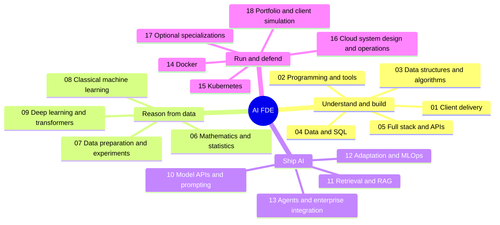

# AI FDE Master Roadmap
## Start Here

1. Use the stage index to choose the next prerequisite you cannot yet demonstrate. Experienced engineers can test out using the expected outcome and gate.
2. Read a topic's What, Why, and Expected fields. Study the linked resources and tick a subtopic only after explaining it and producing a small example or investigation.
3. Add your own `[[Note title]]` links to Notes, and repository/demo/test/report links to Evidence. Blank fields are intentional; no empty note files are created.
4. Mark a stage complete only after its gate works without following a tutorial line by line. Revisit weak areas after each project.
5. Build one evolving Meridian Retail system, then a new-domain capstone. Use one primary cloud before translating the design to the other clouds.

**Depth labels:** `
	 `Build` = independently implement, test, debug, and explain. 
	`Understand` = explain trade-offs and inspect a working implementation. 
	`Specialize` = learn when required by your client/domain;
	 not a prerequisite for the first useful AI product.

**Completion rule for every topic:** 
explanation + working example or analysis + failure/edge-case check + linked evidence. 
Reading alone is not completion.Expected depth applies to every subtopic unless a subtopic explicitly says otherwise. 
Track a blocked topic in your notes with the missing prerequisite rather than ticking it complete.

**Resources and safety:** public documentation and course materials are linked; 
hosted labs/APIs/GPU/cloud use may cost money, and some external platforms offer optional paid features. 


## Source Tracks

| Source                                   | Role in this synthesis                                                           | Main stages            |
| ---------------------------------------- | -------------------------------------------------------------------------------- | ---------------------- |
| [Forward Deployed Engineer][rm-fde]      | Customer discovery, full-stack delivery, enterprise integration, business impact | 01, 04, 05, 13, 18     |
| [AI Engineer][rm-ai]                     | Model APIs, prompting, embeddings, RAG, agents, AI safety                        | 09, 10, 11, 12, 16     |
| [AI and Data Scientist][rm-ds]           | Mathematics, statistics, exploration, experiments, domain modeling               | 06, 07, 08, 17         |
| [System Design][rm-sd]                   | Capacity, networking, storage, caches, messaging, reliability                    | 05, 13, 15, 16         |
| [Machine Learning][rm-ml]                | Feature engineering, classical ML, deep learning, deployment                     | 06, 07, 08, 09, 12, 17 |
| [Docker][rm-docker]                      | Linux prerequisites, images, runtime, persistence, networking, security          | 02, 14                 |
| [Kubernetes][rm-k8s]                     | Workloads, configuration, networking, storage, scheduling, operators             | 15                     |
| [Data Structures and Algorithms][rm-dsa] | Complexity, data structures, algorithms, reasoning and practice                  | 03                     |


## Visual Mind Map



## Stage Index and Gates

| Done | Stage / index | Depth | Entry requirements | Completion gate |
| --- | --- | --- | --- | --- |
| [ ] | [[#01 - Client Delivery and FDE Craft]] | Build | None; revisit throughout | Agree a scoped problem, success metric, risks, and decision owner |
| [ ] | [[#02 - Programming Linux and Engineering Tools]] | Build | Basic computer literacy | Reproduce a tested CLI/service from a clean environment |
| [ ] | [[#03 - Data Structures and Algorithms]] | Build core; Understand advanced | 02 language basics | Solve unfamiliar problems with tests and justified complexity |
| [ ] | [[#04 - Data SQL and Pipelines]] | Build | 02; 03 core collections | Deliver tenant-safe schema and restart-safe ingestion |
| [ ] | [[#05 - Full Stack APIs and Identity]] | Build | 02, 04 | Ship an authenticated, accessible vertical slice |
| [ ] | [[#06 - Mathematics Probability and Statistics]] | Build applied; Understand proofs | 02; basic algebra | Explain gradients, uncertainty, and metric selection |
| [ ] | [[#07 - Data Analysis Features and Experiments]] | Build | 04, 06 | Produce reproducible EDA and a leakage-safe experiment plan |
| [ ] | [[#08 - Classical Machine Learning]] | Build | 06, 07 | Beat a simple baseline on a defensible held-out evaluation |
| [ ] | [[#09 - Deep Learning and Transformers]] | Understand; Build small models | 06, 08 | Train/debug a small model and explain transformer inference |
| [ ] | [[#10 - Model APIs Prompting and AI Product Design]] | Build | 05; 09 overview | Ship a schema-validated feature with regression tests |
| [ ] | [[#11 - Retrieval Search and Production RAG]] | Build | 04, 05, 10 | Evaluate permission-aware retrieval and grounded answers |
| [ ] | [[#12 - Fine Tuning Serving and MLOps]] | Build selected path | 08-11 as relevant | Compare baseline/tuned/served candidates with cost and rollback evidence |
| [ ] | [[#13 - Agents MCP and Enterprise Integration]] | Build | 05, 10, 11 | Resume a bounded workflow and enforce server-side approvals |
| [ ] | [[#14 - Docker and Local Deployment]] | Build | 02, 05 | Rebuild and run the complete stack with durable data |
| [ ] | [[#15 - Kubernetes and Cluster Operations]] | Build core; Understand extensions | 14, networking from 02 | Deploy, diagnose, update, and recover a local cluster workload |
| [ ] | [[#16 - Cloud System Design Security and Reliability]] | Build | 04, 05, 14; 15 for K8s | Deploy on one cloud, observe failures, restore data, defend costs |
| [ ] | [[#17 - Domain and Research Specializations]] | Specialize | Relevant 06-13 topics | Complete a domain-specific benchmark with limitations |
| [ ] | [[#18 - Integrated Projects Portfolio and Hiring]] | Build | Stage gates relevant to project | New-domain client delivery defended with reproducible evidence |

**Suggested route:** 01 + 02 -> core 03 + 04 -> 05 -> 14 -> 10 -> 11 -> 13 -> 15 -> 16 -> 18. Run 06 -> 07 -> 08 -> 09 in parallel as a measured foundations lane, then 12 when needed. Complete 09's transformer overview before 10; you do not need large-scale model training to call a model API. Continue DSA practice alongside builds. Stage 17 is optional. These are competency gates, not fixed calendar promises.

## 01 - Client Delivery and FDE Craft

Source: [FDE roadmap][rm-fde]. Existing curriculum: [[FDE Curriculum Mind Map#M01 - FDE Launchpad]], [[FDE Curriculum Mind Map#M14 - Capstone Simulation]].

### FDE01 - Role and customer discovery
**What:** FDE work connects customer context, engineering implementation, and useful deployment outcomes.
**Why:** A technically impressive solution can still fail if it targets the wrong workflow or owner.
**Expected / depth:** `Build`. Interview stakeholders and produce an evidence-backed problem statement, workflow map, and unknowns list.
- [ ] Map users, sponsor, buyer, security, operations, and decision rights; distinguish pain from proposed solution. [Discovery][discovery] [Notes](Engineering%20Discovery%20Framework%20&%20Client%20Interrogation%20Checklist.md)
- [ ] Observe the current workflow, workarounds, inputs/outputs, and systems of record; record constraints and evidence. [Interviews][interviews]
- [ ] Separate FDE, software/ML/AI engineer, solutions architect, and support responsibilities; agree engagement boundaries. [Role][rm-fde]
- [ ] Test assumptions with a small prototype or data sample and feed reusable findings back to product engineering. [Research][research]
**Notes:** 
**Evidence / questions / next review:** 

### FDE02 - Scoping sequencing and acceptance
**What:** Convert an ambiguous request into an achievable sequence of verifiable outcomes.
**Why:** Scope, integration dependencies, access delays, and acceptance disputes often determine delivery success.
**Expected / depth:** `Build`. Write a PRD-lite/SOW with exclusions, milestones, acceptance tests, owners, and change handling.
- [ ] Define user problem, baseline, success metric, nonfunctional requirements, and measurable acceptance criteria. [Discovery][discovery]
- [ ] Specify in/out of scope, dependencies, assumptions, responsibilities, deadlines, and change-request approval. [SOW guidance][sow]
- [ ] Prioritize by value, risk, uncertainty, and dependency; deliver a thin vertical slice before broad platform work. [Delivery][agile]
- [ ] Make scope/speed/quality trade-offs explicit; record residual risk and avoid silently dropping security or correctness. [ADRs][adr]
**Notes:** 
**Evidence / questions / next review:** 

### FDE03 - Communication architecture and influence
**What:** Explain decisions differently to developers, operators, executives, and risk reviewers without changing the facts.
**Why:** Adoption and sign-off depend on shared understanding, not merely working code.
**Expected / depth:** `Build`. Deliver a short decision memo, a system diagram, and a clear demo with limitations.
- [ ] Use BLUF/Pyramid structure: recommendation, grouped reasons, evidence, risks, and decision requested. [Writing][writing]
- [ ] Draw C4 context/container and sequence/data-flow views with ownership and trust boundaries. [C4][c4]
- [ ] Write ADRs with alternatives, trade-offs, consequences, and review triggers; review code constructively. [ADRs][adr] [Review][review]
- [ ] Run stakeholder demos and incident updates; communicate uncertainty, next update time, and unresolved questions. [Incident communication][incident]
**Notes:** 
**Evidence / questions / next review:** 

### FDE04 - Business value adoption and handover
**What:** Connect technical performance to business outcomes and sustained customer use.
**Why:** Accuracy, latency, and demo excitement do not by themselves establish ROI or successful adoption.
**Expected / depth:** `Build`. Quantify a pilot's value, transfer operational ownership, and distinguish observed benefits from projections.
- [ ] Model task volume, time saved, confirmed resolutions, error/review cost, and implementation/operating costs. [FinOps][finops]
- [ ] Define workflow adoption and user feedback measures; test with representative operators and accessibility needs. [Usability][usability]
- [ ] Produce onboarding, runbooks, permissions/support ownership, rollback limits, and training evidence. [Documentation][diataxis]
- [ ] Establish a product feedback loop and prioritized follow-ups; record acceptance, residual risk, and success measurement window. [Delivery][agile]
**Notes:** 
**Evidence / questions / next review:** 

## 02 - Programming Linux and Engineering Tools

Source: [FDE][rm-fde], [ML prerequisites][rm-ml], [Docker prerequisites][rm-docker]. Existing curriculum: [[FDE Curriculum Mind Map#M02 - Ingestion Pipeline]], [[FDE Curriculum Mind Map#M09 - Linux and Networking]].

### ENG01 - Python programming and type boundaries
**What:** Write readable programs with explicit state, control flow, data models, and error behavior.
**Why:** APIs, ingestion jobs, evaluations, and agents all depend on maintainable application code.
**Expected / depth:** `Build`. Implement a typed CLI that validates inputs, transforms records, and reports actionable failures.
- [ ] Practice values/types, conditions, loops, functions, scope, comprehensions, strings, and file/JSON handling. [Python tutorial][python]
- [ ] Use classes, dataclasses, composition, Protocols, generics, and dependency injection without unnecessary abstraction. [Typing][typing]
- [ ] Implement generators, iterators, decorators, context managers, and custom exceptions with reliable resource cleanup. [Python library][python-lib]
- [ ] Validate external data with schemas; distinguish type annotations, runtime validation, and business invariants. [Pydantic][pydantic]
**Notes:** 
**Evidence / questions / next review:** 

### ENG02 - Git packaging testing and debugging
**What:** Make code changes reproducible, reviewable, testable, and diagnosable.
**Why:** A project that runs only on its author's machine cannot be reliably handed over or deployed.
**Expected / depth:** `Build`. Recreate a repository in a clean environment and run its quality gates with one documented workflow.
- [ ] Use commits/branches, diffs, merges, pull requests, conflict resolution, and safe secret-free repository practices. [Git book][git]
- [ ] Manage pyproject.toml, virtual environments, lockfiles, uv, Ruff/mypy, and pinned interpreter/dependency compatibility. [uv][uv] [mypy][mypy] [Ruff][ruff]
- [ ] Write unit/integration/contract/property tests, fixtures, mocks, and negative cases; interpret coverage without equating it to correctness. [pytest][pytest] [Hypothesis][hypothesis]
- [ ] Reproduce bugs, inspect stack traces/state, profile CPU/memory where justified, and automate checks in CI. [Debugger][pdb] [CI][actions]
**Notes:** 
**Evidence / questions / next review:** 

### ENG03 - Linux shell processes and networking
**What:** Understand the host, process, filesystem, and packet paths beneath application frameworks.
**Why:** Permission errors, connection failures, disk pressure, and process termination recur in every deployment environment.
**Expected / depth:** `Build`. Diagnose a failed service using evidence from permissions, processes, logs, DNS, and sockets.
- [ ] Navigate files/mounts, users/groups, permissions, environment, package managers, SSH keys, and sudo safely. [Ubuntu Server][ubuntu]
- [ ] Inspect processes/signals, CPU/RAM/disk/file descriptors, systemd services, and journals; distinguish symptoms from causes. [Performance tools][linux-perf]
- [ ] Use pipes/redirection, grep/awk/jq, quoting, exit codes, traps, cron/timers, and rerun-safe shell scripts. [Bash][bash] [jq][jq]
- [ ] Trace IP/CIDR, routing, DNS, NAT, TCP/UDP, ports, firewalls, HTTP/TLS, certificates, and proxy boundaries. [Networking textbook][network]
**Notes:** 
**Evidence / questions / next review:** 

### ENG04 - Async concurrency and resilient I O
**What:** Coordinate concurrent tasks while bounding resource use and side effects.
**Why:** Unbounded tasks, blocking calls, retries, and leaked connections can turn a modest workload into an outage.
**Expected / depth:** `Build`. Implement a bounded async worker and prove cancellation, retry limits, and cleanup.
- [ ] Compare event loops, coroutines, gather/TaskGroup, semaphores, bounded queues, cancellation, and deadlines. [asyncio][asyncio]
- [ ] Select threads/processes/async for I/O or CPU work; account for serialization, GIL/interpreter, and shared-state assumptions. [Executors][futures]
- [ ] Reuse HTTP clients, configure connection pools and connect/read/write/pool timeouts, and propagate request IDs. [HTTPX][httpx]
- [ ] Apply jittered backoff, idempotency keys, circuit breakers, DLQs, and backpressure; distinguish transient from permanent failures. [Retry design][retries] [Circuit breaker][circuit]
**Notes:** 
**Evidence / questions / next review:** 

## 03 - Data Structures and Algorithms

Source: [DSA roadmap][rm-dsa]. Use Python first. Practice alongside projects; implement learning exercises yourself but use proven libraries for production core logic.

### DSA01 - Complexity correctness and problem solving
**What:** Analyze resource growth and establish why an algorithm returns the intended result.
**Why:** Helps select indexes/collections and detect accidental quadratic work in real services, not just interviews.
**Expected / depth:** `Build`. Explain an unfamiliar solution's invariants, complexity, alternatives, and edge cases.
- [ ] Calculate time/space costs using Big-O, Big-Theta, Big-Omega; compare constant/logarithmic/linear/polynomial/exponential/factorial growth. [Algorithms text][algorithms]
- [ ] Distinguish worst/average/amortized costs; account for recursion stack, output space, and hidden library work. [Open Data Structures][ods]
- [ ] Turn examples into constraints, pseudocode, invariants, boundary tests, and a brute-force baseline before optimizing. [Practice][exercism]
- [ ] Benchmark realistic inputs and adversarial cases; explain why measured constants and asymptotic claims answer different questions. [Timing][timeit]
**Notes:** 
**Evidence / questions / next review:** 

### DSA02 - Arrays strings maps and linear structures
**What:** Core collections organize sequences, associations, work queues, and history.
**Why:** These structures underpin deduplication, caches, parsers, batching, and scheduling.
**Expected / depth:** `Build`. Select an appropriate collection and solve common sequence problems without unnecessary scans.
- [ ] Compare arrays/dynamic arrays and singly/doubly linked lists; implement traversal, insertion/deletion, and pointer boundary cases. [Structures][ods]
- [ ] Use hash maps/sets; explain collision handling, load factor, membership, counting, and key hashability. [Structures][ods]
- [ ] Apply stacks, queues, deques, monotonic stacks/queues, and circular buffers to realistic workloads. [Python collections][collections]
- [ ] Practice two pointers, sliding windows, prefix sums, frequency maps, and string/Unicode boundary assumptions. [Algorithms][cp-algorithms]
**Notes:** 
**Evidence / questions / next review:** 

### DSA03 - Trees and heaps
**What:** Hierarchical structures support ordered lookup, priority retrieval, indexing, and prefix matching.
**Why:** Makes database indexes, priority workers, top-k retrieval, and structured data easier to reason about.
**Expected / depth:** `Build` traversal/heaps/BST basics; `Understand` balancing internals. Explain costs under both balanced and skewed trees.
- [ ] Traverse binary/general trees with DFS/BFS, recursion and explicit stacks; compare preorder/inorder/postorder. [Trees][ods]
- [ ] Implement BST search/insert/delete; understand AVL/red-black balancing and B/B+ tree disk-page locality. [Trees][ods]
- [ ] Use min/max heaps and priority queues for top-k, k-way merge, and scheduling; distinguish a heap from a sorted sequence. [heapq][heapq]
- [ ] Build a trie for prefixes; understand segment/Fenwick trees and range queries as advanced, workload-driven extensions. [Advanced structures][cp-algorithms]
**Notes:** 
**Evidence / questions / next review:** 

### DSA04 - Graph algorithms
**What:** Model entities and relationships, then reason about reachability, dependencies, and path cost.
**Why:** Applies to workflow DAGs, service dependencies, knowledge graphs, routes, and deadlock reasoning.
**Expected / depth:** `Build` BFS/DFS/topological order; `Understand` weighted-path and spanning-tree selection with assumptions.
- [ ] Compare directed/undirected and weighted/unweighted graphs, adjacency lists/matrices, and traversal complexity. [Graphs][algorithms]
- [ ] Detect cycles/components, perform BFS/DFS and topological sorting, and distinguish dependency DAGs from arbitrary graphs. [Graph techniques][cp-algorithms]
- [ ] Compare Dijkstra, Bellman-Ford, Floyd-Warshall, and A*; state nonnegative-weight/heuristic assumptions. [Shortest paths][cp-algorithms]
- [ ] Use union-find; compare Prim/Kruskal minimum spanning trees, connectivity, and why MST is not a shortest-path tree. [Connectivity][cp-algorithms]
**Notes:** 
**Evidence / questions / next review:** 

### DSA05 - Search sorting recursion and optimization
**What:** Reusable algorithmic strategies reduce a large problem to a smaller searchable or optimizable state space.
**Why:** Supports ranking, batching, allocation, parsing, and efficient reasoning under interview or delivery pressure.
**Expected / depth:** `Build` binary search, standard sorting reasoning, recursion, and simple DP; justify when a strategy is valid.
- [ ] Implement linear/binary search and lower/upper bounds with explicit interval invariants and duplicate handling. [Search][algorithms]
- [ ] Compare bubble/selection/insertion/merge/quick/heap sorts for stability, memory, worst cases, and practical library behavior. [Sorting][algorithms]
- [ ] Practice recursion, backtracking, divide-and-conquer, greedy choice/counterexamples, memoization, and bottom-up dynamic programming. [Techniques][cp-algorithms]
- [ ] Understand bit operations, integer/overflow assumptions, modular arithmetic, and advanced string matching as needed; maintain a mistake log and retest spaced practice. [Practice][exercism] [Reference][cp-algorithms]
**Notes:** 
**Evidence / questions / next review:** 

## 04 - Data SQL and Pipelines

Source: [FDE][rm-fde], [ML][rm-ml], [System design][rm-sd]. Existing curriculum: [[FDE Curriculum Mind Map#M01 - FDE Launchpad]], [[FDE Curriculum Mind Map#M02 - Ingestion Pipeline]], [[FDE Curriculum Mind Map#M03 - Platform Backend]].

### DATA01 - Relational modeling and production SQL
**What:** Represent business facts with explicit keys, constraints, relationships, and query semantics.
**Why:** Correct data and transactions are the foundation of trustworthy analytics and safe agent actions.
**Expected / depth:** `Build`. Design orders/payments/inventory tables and prove queries do not double-count or violate invariants.
- [ ] Define table grain, keys/cardinality, constraints, normalization/denormalization, money/timestamps, and tenant-scoped uniqueness. [Postgres DDL][pg-ddl]
- [ ] Write joins, subqueries/CTEs, aggregates, conditional logic, NULL-safe predicates, and window functions. [Postgres SQL][pg-sql]
- [ ] Use transactions, isolation, locks, optimistic versions, retries, and atomic inventory updates; reproduce concurrent failure cases. [Concurrency][pg-concurrency]
- [ ] Inspect EXPLAIN/BUFFERS, indexes/statistics, slow queries, views/materialized views, and safe schema migrations. [Performance][pg-explain] [Migrations][alembic]
**Notes:** 
**Evidence / questions / next review:** 

### DATA02 - Storage formats quality and ingestion
**What:** Move external records into reliable, typed datasets while preserving raw evidence and progress.
**Why:** Messy source data and partial ingestion are frequent root causes of broken downstream AI behavior.
**Expected / depth:** `Build`. Stream a large synthetic feed with bounded memory, quarantine bad records, and rerun without duplicates.
- [ ] Compare CSV/JSON/Excel/Parquet/Arrow, encodings, schema inference/evolution, compression, and chunk boundaries. [DuckDB data guides][duckdb]
- [ ] Profile missingness, ranges, duplicates, referential coverage, time zones, and schema drift with explicit data contracts. [Data quality][great-expectations]
- [ ] Implement streaming/chunking, business keys, checksums, idempotent writes, checkpoints/watermarks, and dead-letter handling. [Pipeline design][debezium]
- [ ] Compare batch/CDC/streaming, late/out-of-order events, deletes, replay, and Bronze/Silver/Gold ownership. [Medallion][medallion]
**Notes:** 
**Evidence / questions / next review:** 

### DATA03 - Analytics distributed processing and orchestration
**What:** Transform source records into tested analytical models using the simplest adequate execution engine.
**Why:** Enterprise delivery often requires both operational APIs and explainable business reporting.
**Expected / depth:** `Build` a local DuckDB/dbt pipeline; use Spark when volume or runtime measurements justify distribution.
- [ ] Define facts/dimensions, surrogate keys, SCD Type 2, metrics, staging/marts, and dbt tests/lineage. [dbt][dbt] [Dimensional modeling][kimball]
- [ ] Compare OLTP/OLAP/HTAP and row/column storage; choose local analytics, warehouse, or lakehouse from workload evidence. [DuckDB][duckdb]
- [ ] Explain Spark driver/executors, lazy plans/actions, partitions/shuffles, joins/skew, AQE, and Parquet/Delta/Iceberg tables. [Spark][spark]
- [ ] Build Airflow/Prefect DAGs with interval-idempotent backfills, retries, sensors, secret injection, and owned alerts. [Airflow][airflow]
**Notes:** 
**Evidence / questions / next review:** 

### DATA04 - Tenant permissions retention and governance
**What:** Enforce who can see/change data and how it is retained, traced, and erased.
**Why:** A single cross-tenant retrieval or leaked backup can invalidate an otherwise successful AI deployment.
**Expected / depth:** `Build`. Demonstrate negative access tests and trace source-to-derived data ownership and deletion behavior.
- [ ] Apply least-privilege roles, RLS USING/WITH CHECK, transaction-scoped tenant context, and pooled-connection isolation. [Postgres RLS][rls]
- [ ] Classify PII, use appropriate at-rest/in-transit encryption, separate key ownership, and redact logs/audit records. [Privacy/security][owasp]
- [ ] Map lineage, consent/license, retention, provenance, access reviews, and source-document/embedding deletion propagation. [Data governance][nist-ai]
- [ ] Test backup restore, erasure boundaries, migration recovery, and audit evidence; do not equate a control checklist with compliance certification. [Backups][pg-backup]
**Notes:** 
**Evidence / questions / next review:** 

## 05 - Full Stack APIs and Identity

Source: [FDE][rm-fde], [System design][rm-sd]. Existing curriculum: [[FDE Curriculum Mind Map#M03 - Platform Backend]], [[FDE Curriculum Mind Map#M04 - Frontend Layer]].

### WEB01 - HTTP APIs and backend services
**What:** Expose domain operations through explicit, validated, observable interfaces.
**Why:** Frontends, models, agents, and enterprise connectors all consume service contracts.
**Expected / depth:** `Build`. Ship a tested FastAPI service with typed contracts, safe transactions, and predictable failure behavior.
- [ ] Model REST resources, methods/status/errors, cursor pagination, filtering, versioning, and OpenAPI contracts. [API design][api-design]
- [ ] Use routers/dependencies/middleware/lifespan, Pydantic schemas, async SQLAlchemy sessions, and durable background work. [FastAPI][fastapi] [SQLAlchemy][sqlalchemy]
- [ ] Handle webhooks, HMAC raw-body verification, idempotency, payments, domain state machines, and transactional outbox. [Webhooks][stripe] [Outbox][outbox]
- [ ] Test contract compatibility, authorization, boundaries, timeouts, and third-party failure; generate a typed frontend SDK. [Contract tests][schemathesis] [OpenAPI][openapi]
**Notes:** 
**Evidence / questions / next review:** 

### WEB02 - Frontend foundations and typed React
**What:** Build a browser interface that makes real workflows understandable and efficient.
**Why:** Client adoption depends on usable operations, not an API-only demo or a decorative chat screen.
**Expected / depth:** `Build`. Deliver a responsive, accessible operations dashboard with validated forms and real API data.
- [ ] Explain DOM/CSSOM/rendering/event loop; use semantic HTML, CSS Grid/Flexbox, keyboard focus, labels, and responsive overflow. [Web foundations][mdn]
- [ ] Learn JavaScript async/modules and strict TypeScript, unions/generics/nullability, runtime validation, Fetch and AbortController. [TypeScript][ts] [Fetch][fetch]
- [ ] Use React composition, state ownership, effects for synchronization, hooks, React Hook Form/Zod, and server-state caching. [React][react] [TanStack Query][query]
- [ ] Build tables/filtering/charts, routing/URL state, loading/error/empty states; compare CSR/SSR/SSG/RSC/Next only as product needs require. [Tables][table] [Next][next]
**Notes:** 
**Evidence / questions / next review:** 

### WEB03 - Authentication authorization and application security
**What:** Verify identity, enforce allowed actions, and defend trust boundaries on every request.
**Why:** UI route guards or model instructions are not an authorization system.
**Expected / depth:** `Build`. Integrate maintained identity libraries and prove role/object/tenant restrictions against direct API calls.
- [ ] Distinguish OAuth2/OIDC, ID/access/refresh tokens, PKCE, state/nonce, scopes, and service/workload identities. [OAuth security][oauth] [OIDC][oidc]
- [ ] Validate JWT signatures/algorithms/issuer/audience/expiry and JWKS rotation; design secure cookie/token/session lifecycle. [JWT guidance][jwt] [Session security][sessions]
- [ ] Apply deny-by-default RBAC/object ownership, tenant propagation, API key scopes, rate limits, and secret rotation. [Authorization][authz]
- [ ] Prevent injection/XSS/CSRF/SSRF, unsafe file uploads, insecure CORS, and sensitive logging; test only authorized lab endpoints. [OWASP cheat sheets][owasp]
**Notes:** 
**Evidence / questions / next review:** 

### WEB04 - Real time testing and user enablement
**What:** Keep UI state trustworthy during live updates, slow requests, failures, and changes.
**Why:** Streaming and optimistic updates can mislead operators unless reconciliation and failure states are explicit.
**Expected / depth:** `Build`. Demonstrate a reconnecting live workflow and E2E tests covering success, denial, and degraded behavior.
- [ ] Compare WebSockets/SSE/polling, heartbeats, reconnects, event IDs/order, snapshot reconciliation, and proxy buffering. [SSE][sse] [WebSockets][ws]
- [ ] Render AI streams safely with citations, cancel/retry/partial failure, tool progress, and explicit approval state. [AI SDK][ai-sdk]
- [ ] Test components with accessible queries, E2E with Playwright, performance/CWV, and keyboard/mobile layouts. [Testing Library][rtl] [Playwright][playwright] [Web vitals][vitals]
- [ ] Run observed user tasks, collect feedback, document business procedures and support ownership, and rehearse handover. [Usability][usability] [Documentation][diataxis]
**Notes:** 
**Evidence / questions / next review:** 

## 06 - Mathematics Probability and Statistics

Source: [AI/data scientist][rm-ds], [ML][rm-ml]. Existing lessons: [[Lesson 2 - TRANSFORMER MASTERY COURSE]], [[Lesson 3 - TRANSFORMER MASTERY COURSE]], [[Lesson 10 — Training- How the Transformer Actually Learns]]. Learn enough applied math to reason about models; formal proofs are a separate depth choice.

### MATH01 - Linear algebra and numerical computing
**What:** Represent features, embeddings, and transformations using vectors, matrices, and tensors.
**Why:** Shapes, projections, distance, and numerical behavior determine whether model code is meaningful.
**Expected / depth:** `Build` shape-safe NumPy calculations; `Understand` spectral/decomposition concepts and their uses.
- [ ] Calculate vector/matrix products, transposes, broadcasting, norms, dot/cosine similarity, projections, and tensor shapes. [Math for ML][mml] [NumPy][numpy]
- [ ] Explain rank, linear independence, determinants/inverses, linear systems, and why solvers are preferable to explicit inversion. [Linear algebra][mml]
- [ ] Understand eigenvalues/eigenvectors, diagonalization, SVD, PCA, and low-rank approximation with a small numerical example. [Math for ML][mml]
- [ ] Inspect precision, overflow/underflow, stable softmax/log-sum-exp, conditioning, and reproducible random sampling. [SciPy][scipy] [NumPy][numpy]
**Notes:** 
**Evidence / questions / next review:** 

### MATH02 - Calculus optimization and information
**What:** Measure how outputs/losses change and use gradients to improve parameters.
**Why:** Explains training, learning rates, regularization, and common instability rather than treating fit() as magic.
**Expected / depth:** `Build` a finite-difference gradient check and simple optimizer; `Understand` higher-order quantities.
- [ ] Apply derivatives/partial derivatives, chain rule, gradients, Jacobians, Hessians, and vectorized shape reasoning. [Math for ML][mml]
- [ ] Compare gradient descent/SGD/momentum/Adam, learning-rate schedules, convex/nonconvex objectives, and local curvature. [Optimization][d2l]
- [ ] Explain regularization, constraints, weight decay, loss scaling, and vanishing/exploding gradients. [Deep learning][d2l]
- [ ] Interpret entropy, cross-entropy, KL divergence, likelihood/log-likelihood, and numerical stability in classification/generation. [Information and probability][mml]
**Notes:** 
**Evidence / questions / next review:** 

### MATH03 - Probability distributions and sampling
**What:** Model uncertain outcomes and distinguish samples from the population/process that produced them.
**Why:** Evaluation, experimentation, risk estimates, and model outputs all involve uncertainty and sampling assumptions.
**Expected / depth:** `Build`. Simulate simple distributions and explain independence, conditional probability, and uncertainty in plain language.
- [ ] Work with events, conditional probability, independence, Bayes' theorem, random variables, PMF/PDF/CDF, and joint distributions. [Probability][stat110]
- [ ] Calculate expectation/variance/covariance/correlation; distinguish association from causality and uncorrelated from independent. [Statistics][openintro]
- [ ] Compare Bernoulli/binomial, normal, uniform, Poisson, exponential, and heavy-tail behavior; justify distribution assumptions. [Probability][stat110]
- [ ] Explain random/stratified/cluster sampling, selection bias, LLN/CLT conditions, Monte Carlo simulation, and bootstrap uncertainty. [Statistics][openintro]
**Notes:** 
**Evidence / questions / next review:** 

### MATH04 - Statistical inference and decision making
**What:** Use sampled observations to estimate effects and evaluate competing explanations.
**Why:** Prevents overclaiming improvements from noisy benchmarks or small customer pilots.
**Expected / depth:** `Build`. Report an effect size and uncertainty, choose an appropriate test, and state what the analysis cannot establish.
- [ ] Distinguish estimators, confidence/credible intervals, null/alternative hypotheses, p-values, effect size, and practical significance. [Statistics][openintro]
- [ ] Compare t/z/chi-square/nonparametric tests; inspect independence, distribution, and sample-size assumptions. [SciPy statistics][scipy-stats]
- [ ] Reason about Type I/II error, power, minimum detectable effect, multiple testing, peeking, and preregistered stopping rules. [Experimentation][experiments]
- [ ] Understand Bayesian updating, priors/posteriors, regression uncertainty, and decision thresholds driven by error costs. [Bayesian introduction][bayes]
**Notes:** 
**Evidence / questions / next review:** 

## 07 - Data Analysis Features and Experiments

Source: [AI/data scientist][rm-ds], [ML][rm-ml]. Prerequisites: 04 and 06. Outcome: a reproducible analysis and defensible experimental design, not merely attractive charts.

### ANALYSIS01 - Data acquisition and exploratory analysis
**What:** Inspect how data was generated, what each row means, and which patterns or quality issues matter.
**Why:** Modeling cannot repair a misleading target, biased sample, incorrect join, or unrepresentative dataset.
**Expected / depth:** `Build`. Produce an EDA report with provenance, quality tests, distributions, segment comparisons, and limitations.
- [ ] Acquire permissioned SQL/API/file data; document collection context, identifiers, time windows, labeling process, and license. [pandas][pandas]
- [ ] Inspect dtypes, missingness, duplicates, outliers, class balance, and temporal/segment coverage before cleaning. [pandas guide][pandas]
- [ ] Use vectorized NumPy/pandas operations, robust descriptive statistics, distributions, correlations, and group comparisons. [NumPy][numpy] [Statistics][openintro]
- [ ] Choose honest Matplotlib/Seaborn charts, units/scales, accessible colors, and uncertainty displays; separate observations from causal claims. [Matplotlib][matplotlib] [Seaborn][seaborn]
**Notes:** 
**Evidence / questions / next review:** 

### ANALYSIS02 - Cleaning preprocessing and feature engineering
**What:** Convert raw inputs into stable representations suitable for an identified modeling task.
**Why:** Leakage, train/serve skew, and inconsistent preprocessing often dominate algorithm choice.
**Expected / depth:** `Build`. Fit preprocessing on training data only and apply the same versioned pipeline to validation and serving.
- [ ] Define missing-value strategies, categorical encoding, scaling, robust outlier treatment, units, and invalid-value policies. [Preprocessing][sk-preprocess]
- [ ] Create aggregates, dates/lags, text/numerical features, interactions, and domain-derived features with availability timestamps. [Feature examples][sk-examples]
- [ ] Compare feature selection, regularization, PCA/other dimensionality reduction, and feature importance without using holdout labels for decisions. [Selection][sk-feature] [Decomposition][sk-decomp]
- [ ] Use pipelines/column transformers; test leakage, entity/time splits, transformations on unseen categories, and training-serving consistency. [Pipelines][sk-pipeline] [Pitfalls][sk-pitfalls]
**Notes:** 
**Evidence / questions / next review:** 

### ANALYSIS03 - Experiments causal questions and product metrics
**What:** Design comparisons that distinguish noise, confounding, and genuine changes in business outcomes.
**Why:** Shipping an AI feature because an offline score increased can harm users or create no measurable value.
**Expected / depth:** `Build` basic randomized experiments; `Understand` advanced variance reduction and causal-identification limits.
- [ ] Define hypothesis, unit of randomization, primary/guardrail metrics, eligibility, sample size, MDE, power, and stopping rules. [Experimentation][experiments]
- [ ] Check sample-ratio mismatch, novelty/seasonality, spillover, attrition, assignment consistency, and multiple comparisons. [Experimentation][experiments]
- [ ] Understand ratio metrics/delta method, stratification, CUPED/CUPAC, sequential testing, and when specialist review is required. [Research resources][experiments]
- [ ] Distinguish randomized evidence from observational regression; identify confounding, selection bias, causal diagrams, and counterfactual assumptions. [Causal inference book][causal]
**Notes:** 
**Evidence / questions / next review:** 

### ANALYSIS04 - Analytical reporting and decision artifacts
**What:** Translate an analysis into a reproducible recommendation a stakeholder can inspect and act on.
**Why:** Findings only create value when metric definitions, uncertainty, ownership, and follow-up are clear.
**Expected / depth:** `Build`. Deliver a decision memo supported by rerunnable code/SQL and a documented dataset snapshot.
- [ ] Define metric denominator/grain, currency/time zones, freshness, cohort, returns, and missing-data treatment. [Metrics][dbt]
- [ ] Package reproducible notebooks/scripts with environment, inputs, random seeds, figures, and analysis assumptions. [Reproducibility][sk-pitfalls]
- [ ] Present effect sizes, uncertainty, segment differences, cost/risk, and limitations without cherry-picking favorable results. [Statistics][openintro]
- [ ] State recommendation, owner, decision deadline, implementation cost, and how the next observation could falsify the recommendation. [Technical writing][writing]
**Notes:** 
**Evidence / questions / next review:** 

## 08 - Classical Machine Learning

Source: [ML][rm-ml], [AI/data scientist][rm-ds]. Prerequisites: 06-07. Build useful baselines before deep learning or LLM fine-tuning.

### ML01 - Problem formulation baselines and validation
**What:** Translate a business decision into a target, prediction horizon, data split, and evaluation objective.
**Why:** A leakage-heavy or irrelevant benchmark can make a useless model look excellent.
**Expected / depth:** `Build`. Define a defensible train/validation/test protocol and compare against a trivial/business-rule baseline.
- [ ] Distinguish supervised/unsupervised/semi/self-supervised and reinforcement learning; identify prediction versus intervention tasks. [ML overview][sk-guide]
- [ ] Define features available at prediction time, target construction, horizon, entity boundaries, and label delay. [Common pitfalls][sk-pitfalls]
- [ ] Use random/stratified/group/temporal splits, cross-validation, nested tuning where needed, and an untouched final holdout. [Model selection][sk-cv]
- [ ] Build majority/mean/rule/linear baselines; diagnose bias/variance and learning curves before adding model complexity. [Learning curves][sk-learning]
**Notes:** 
**Evidence / questions / next review:** 

### ML02 - Regression classification and decision thresholds
**What:** Fit models for numerical outcomes or class probabilities and convert predictions into decisions.
**Why:** Many enterprise problems are solved faster and more cheaply with small supervised models than generative AI.
**Expected / depth:** `Build`. Train/evaluate linear/logistic and alternative classifiers/regressors, then select a threshold using error costs.
- [ ] Compare linear/polynomial regression, ridge/lasso/elastic net, logistic regression, and coefficient/feature-scale interpretation. [Linear models][sk-linear]
- [ ] Understand k-NN, naive Bayes, SVM/kernels, distance metrics, and their data/latency/scaling assumptions. [Supervised learning][sk-supervised]
- [ ] Choose MAE/MSE/RMSE/R-squared or precision/recall/F1/ROC-AUC/PR-AUC/log-loss; inspect class imbalance and subgroup errors. [Metrics][sk-metrics]
- [ ] Evaluate probability calibration, threshold trade-offs, abstention, and expected business costs; avoid reporting accuracy alone. [Calibration][sk-calibration]
**Notes:** 
**Evidence / questions / next review:** 

### ML03 - Trees ensembles tuning and interpretation
**What:** Combine nonlinear partitioning and multiple models to improve tabular prediction.
**Why:** Trees and boosting provide strong practical baselines but still require careful tuning and explanation.
**Expected / depth:** `Build`. Compare a tree, random forest, and boosting baseline under the same validation protocol.
- [ ] Explain decision splits/impurity, leaf size, depth, pruning, overfitting, and categorical/missing-value handling. [Decision trees][sk-tree]
- [ ] Compare bagging/random forests, gradient boosting, XGBoost/LightGBM/CatBoost, and stacking with leakage-safe out-of-fold training. [Ensembles][sk-ensemble] [XGBoost][xgboost]
- [ ] Use grid/random/Bayesian search, early stopping, bounded compute budgets, and reproducible experiment tracking. [Hyperparameter search][sk-search] [Optuna][optuna]
- [ ] Inspect permutation importance, partial dependence and SHAP limitations, correlated features, subgroup performance, and explanation stability. [Inspection][sk-inspection] [SHAP][shap]
**Notes:** 
**Evidence / questions / next review:** 

### ML04 - Unsupervised learning anomalies and compression
**What:** Discover structure or unusual cases without assuming a supervised target is available.
**Why:** Useful for segmentation, exploratory grouping, representation compression, and anomaly triage, but easy to overinterpret.
**Expected / depth:** `Build` a clustering/anomaly baseline; explain sensitivity to scaling, density, and validation assumptions.
- [ ] Compare k-means, hierarchical clustering, DBSCAN, Gaussian mixtures, distance choice, and scaling requirements. [Clustering][sk-cluster]
- [ ] Evaluate silhouette/stability/domain usefulness; distinguish visually separated groups from externally valid business segments. [Clustering evaluation][sk-cluster]
- [ ] Use PCA/NMF and understand t-SNE/UMAP visualization limits, neighborhood distortion, and stochasticity. [Decomposition][sk-decomp] [Manifold][sk-manifold]
- [ ] Compare isolation forest, density/neighbor methods, one-class models, and reconstruction errors; calibrate alert thresholds and feedback. [Novelty/outlier detection][sk-outlier]
**Notes:** 
**Evidence / questions / next review:** 

## 09 - Deep Learning and Transformers

Source: [ML][rm-ml], [AI/data scientist][rm-ds], [AI engineer][rm-ai]. Existing foundations: [[Knowledge Base Map]]. Training a small model is a learning exercise; foundation-model pretraining is not a prerequisite for FDE delivery.

### DL01 - Neural networks and automatic differentiation
**What:** Compose trainable tensor operations and differentiate a loss through them.
**Why:** Explains learned representations, optimization, and the memory/compute behavior behind modern models.
**Expected / depth:** `Build`. Train a small MLP in PyTorch and verify forward/backward shapes and gradients.
- [ ] Work with tensors/devices, broadcasting, autograd graphs, parameters, modules, and no_grad/inference mode. [PyTorch basics][pytorch]
- [ ] Define dense layers, activations, initialization, losses, batches, optimizers, and a minimal training/evaluation loop. [Training][pytorch] [Theory][d2l]
- [ ] Apply normalization, dropout, regularization, learning-rate schedules, and appropriate preprocessing. [Deep learning][d2l]
- [ ] Test reproducibility, gradient flow, finite values, parameter updates, device movement, and checkpoint save/load. [PyTorch recipes][pytorch-recipes]
**Notes:** 
**Evidence / questions / next review:** 

### DL02 - Training diagnostics and model evaluation
**What:** Diagnose whether a neural model is learning the intended task and generalizing to unseen inputs.
**Why:** Loss curves can look plausible while labels, masks, evaluation mode, or data splits are wrong.
**Expected / depth:** `Build`. Overfit a tiny batch intentionally, diagnose a broken run, and choose a checkpoint using held-out evidence.
- [ ] Inspect training/validation curves, train/eval modes, under/overfitting, leakage, and label/input alignment. [Training guidance][d2l]
- [ ] Monitor gradients, activations, learning rate, exploding/vanishing signals, and mixed-precision behavior. [PyTorch recipes][pytorch-recipes]
- [ ] Use early stopping, checkpoint selection, seed sensitivity, ablations, and task-specific subgroup evaluation. [Model evaluation][sk-metrics]
- [ ] Record code/data/configuration lineage and compare resource/quality budgets rather than only best-case scores. [MLflow][mlflow]
**Notes:** 
**Evidence / questions / next review:** 

### DL03 - Architecture families and representation learning
**What:** Understand how architecture encodes assumptions about images, sequences, and other structured inputs.
**Why:** Helps select a pretrained model and recognize when an LLM is the wrong tool.
**Expected / depth:** `Understand` core architectures; `Build` one small transfer-learning example when relevant.
- [ ] Explain convolutions, receptive fields, pooling, residual networks, and vision transfer learning. [Vision tutorial][torchvision]
- [ ] Compare RNN/LSTM/GRU state, sequence masking, bidirectionality, teacher forcing, and long-range limitations. [Sequence models][d2l]
- [ ] Distinguish autoencoders, contrastive/self-supervised learning, embeddings, and supervised feature extractors. [Representation learning][d2l]
- [ ] Understand transfer learning, frozen backbones, task heads, domain shift, and the role of pretrained weights. [Hugging Face course][hf-course]
**Notes:** 
**Evidence / questions / next review:** 

### DL04 - Attention tokenization and transformer mechanics
**What:** Use token representations, positional information, and attention to condition predictions on context.
**Why:** Explains context limits, masking, embedding similarity, generation behavior, and many inference costs.
**Expected / depth:** `Understand` each component; `Build` a tiny attention computation with correct shapes and masks.
- [ ] Compare word/subword/byte tokenization, vocabulary, special tokens, padding/truncation, embeddings, and positional encodings. [Tokenizers][hf-course]
- [ ] Compute scaled dot-product attention, Q/K/V, multi-head projection, causal/padding masks, residuals, LayerNorm, and feed-forward blocks. [Illustrated implementation][annotated-transformer]
- [ ] Compare encoder-only, decoder-only, and encoder-decoder architectures and task/training objectives. [Transformers][hf-course]
- [ ] Explain next-token prediction, cross-entropy, autoregressive generation, KV caching, and why fluent text is not a truth guarantee. [Generation][hf-generation]
**Notes:** [[Attention Is All You Need]]; [[Lesson 16- The Transformer — Opening the Black Box]]
**Evidence / questions / next review:** 

## 10 - Model APIs Prompting and AI Product Design

Source: [AI engineer][rm-ai], [FDE][rm-fde]. Existing curriculum: [[FDE Curriculum Mind Map#M05 - Production RAG]]. Prerequisites: 05 and the transformer overview in 09.

### AI01 - Model landscape access and selection
**What:** Choose an appropriate pretrained model and access method for a real task.
**Why:** Bigger, newer, reasoning-enabled, or locally hosted does not automatically mean better for your workflow.
**Expected / depth:** `Build`. Compare at least two candidates on a permissioned task set with quality/latency/cost/privacy evidence.
- [ ] Distinguish AI/ML/deep learning/generative AI, training/inference, AI versus AGI terminology, and AI engineer versus ML engineer responsibilities. [AI roadmap][rm-ai]
- [ ] Compare open weights versus open source versus closed APIs, licenses, model cards, dense/MoE and reasoning/non-reasoning behavior. [Model cards][hf-cards]
- [ ] Use maintained provider SDKs or local tools such as Ollama/LM Studio/Hugging Face; verify hardware, version, and data-handling constraints. [Ollama][ollama] [HF inference][hf-inference]
- [ ] Evaluate context/output limits, supported modalities/tools/schemas, quotas, regions, retention, reliability, and full task cost. [Model evaluations][evals]
**Notes:** 
**Evidence / questions / next review:** 

### AI02 - Prompt design and structured contracts
**What:** Express task instructions, context boundaries, examples, and output requirements clearly.
**Why:** Prompting is an interface design tool, but cannot replace validation, authorization, or external facts.
**Expected / depth:** `Build`. Produce a versioned prompt/schema pack with regression cases and safe error handling.
- [ ] Separate trusted instructions, user content, retrieved/tool data, and few-shot examples; test ambiguity and conflicting content. [Prompting][prompting]
- [ ] Compare zero/few-shot, decomposition, explicit plans, and ReAct-style interaction without relying on access to private chain-of-thought. [Agent patterns][agents]
- [ ] Use schema-constrained outputs/tool schemas, strict validation, refusal/truncation handling, and bounded repair retries. [Structured outputs][structured]
- [ ] Version templates, variables, examples, model settings, and golden test cases; test paraphrases, ordering, languages, and missing data. [Promptfoo][promptfoo]
**Notes:** 
**Evidence / questions / next review:** 

### AI03 - Inference parameters streaming and integration
**What:** Control generation and integrate model output into a responsive service with a defined failure contract.
**Why:** Timeout, cancellation, parsing, and token-budget behavior determine production usability and spend.
**Expected / depth:** `Build`. Implement a provider adapter with streaming, cancellation, cost accounting, and bounded fallback.
- [ ] Explain tokens/context budgeting, temperature/top-p/top-k where supported, output caps, stop conditions, and determinism limits. [Generation][hf-generation]
- [ ] Parse streaming events, measure TTFT/inter-token latency/total latency, and handle disconnection, refusal, and partial output. [AI SDK][ai-sdk]
- [ ] Configure SDK/client lifecycle, timeouts, retries, request IDs, quota handling, and provider capability differences. [LiteLLM][litellm] [Retries][retries]
- [ ] Compare exact-prefix prompt caching and semantic answer caching with TTL/version/tenant isolation and quality-safe fallbacks. [Prompt caching][prompt-cache] [Semantic caching][redisvl]
**Notes:** 
**Evidence / questions / next review:** 

### AI04 - Evaluation safety and human centered AI
**What:** Measure task usefulness and test foreseeable failures before exposing users to model output or actions.
**Why:** Helpful-looking outputs can be fabricated, biased, unsafe, private, or overconfident.
**Expected / depth:** `Build`. Maintain a stratified evaluation set, calibrated review process, adversarial cases, and escalation policy.
- [ ] Distinguish deterministic assertions, reference metrics, model judges, and human review; calibrate judges and report uncertainty/error categories. [Evaluation practices][evals]
- [ ] Test prompt injection, disclosure, harmful/bias scenarios, policy failures, and provider moderation limitations with synthetic cases. [LLM risks][llm-owasp] [Red teaming][pyrit]
- [ ] Apply PII redaction/content policy, grounding/abstention, clear user-visible uncertainty, and mandatory escalation for high-impact decisions. [Presidio][presidio] [Human-AI interaction][human-ai]
- [ ] Map data flows, consent/retention, fairness/accessibility, risk owners, and incident handling; an end-user ID in a prompt is not isolation. [NIST AI RMF][nist-ai]
**Notes:** 
**Evidence / questions / next review:** 

## 11 - Retrieval Search and Production RAG

Source: [AI engineer][rm-ai], [System design][rm-sd]. Existing curriculum: [[FDE Curriculum Mind Map#M05 - Production RAG]], [[Lesson 19- Embeddings, Semantic Search & RAG — Giving the Model a Library]].

### RAG01 - Knowledge ingestion parsing and chunking
**What:** Turn permissioned documents into versioned, traceable retrieval units without destroying their meaning.
**Why:** Lost table structure, stale documents, missing ACLs, and bad chunk boundaries undermine even strong models.
**Expected / depth:** `Build`. Ingest a mixed-format corpus and trace any retrieved chunk back to a source version/page/permission.
- [ ] Inventory sources, licenses, owners, update/deletion policy, and user/document access rules before embedding. [Governance][nist-ai]
- [ ] Parse PDF/HTML/Office/images, OCR/layout/tables, reading order, and extraction failures against source samples. [Docling][docling]
- [ ] Compare fixed/recursive/structural/semantic chunks, overlap, parent-child context, and token-aware size limits. [Retrieval guide][rag-guide]
- [ ] Preserve IDs, metadata/provenance, hashes, timestamps, tenant/ACL scope, ingestion versions, and quarantine/reprocessing routes. [Vector metadata][pgvector] [Data quality][great-expectations]
**Notes:** 
**Evidence / questions / next review:** 

### RAG02 - Embeddings similarity and vector storage
**What:** Map queries/documents into representations that support useful nearest-neighbor comparisons.
**Why:** Model/distance/dimension mismatches and unsafe filtering can produce irrelevant or unauthorized results.
**Expected / depth:** `Build`. Compare embedding candidates and index settings on a labeled, permission-aware query set.
- [ ] Compare semantic/sparse/dense embeddings, bi-encoders, cosine/dot/L2, normalization, model dimensions, and multilingual/domain fit. [Sentence Transformers][sbert]
- [ ] Use pgvector or a managed/dedicated vector engine; define payload indexes, metadata filters, schema, backups, and deletion behavior. [pgvector][pgvector] [Qdrant][qdrant]
- [ ] Explain exact versus ANN, HNSW/IVF, scalar/product quantization, ScaNN/DiskANN concepts, recall/latency, and memory trade-offs. [Faiss][faiss] [DiskANN][diskann]
- [ ] Version/rebuild embeddings and indexes, test filtered recall, and compare providers without assuming dimension compatibility. [Embedding evaluation][sbert]
**Notes:** 
**Evidence / questions / next review:** 

### RAG03 - Lexical hybrid retrieval and reranking
**What:** Assemble a high-quality authorized candidate set before generating an answer.
**Why:** A generation model cannot ground an answer in evidence retrieval failed to find.
**Expected / depth:** `Build`. Establish dense/lexical baselines and improve retrieval measurably with hybrid search and reranking.
- [ ] Understand inverted indexes, tokenization/analyzers, BM25, exact phrase/identifier matching, and language effects. [Information retrieval book][ir]
- [ ] Combine lexical/dense candidates with RRF or evaluated fusion; enforce tenant/document access before exposing content. [OpenSearch hybrid][hybrid]
- [ ] Use cross-encoder rerankers, candidate budgets, deduplication, diversification, and query rewriting/decomposition only when measured useful. [Retrieve and rerank][rerank]
- [ ] Measure Recall@k/MRR/NDCG, segment by query type, inspect failures, and balance relevance against latency/cost. [Retrieval evaluation][ir]
**Notes:** 
**Evidence / questions / next review:** 

### RAG04 - Grounded generation citations and evaluation
**What:** Generate a useful response from retrieved evidence while exposing sources and uncertainty.
**Why:** Retrieved text alone does not prevent hallucination, citation fabrication, or unsupported reasoning.
**Expected / depth:** `Build`. Return supported citations or abstention and evaluate retrieval and generation separately.
- [ ] Construct a bounded context pack, delimit untrusted documents, preserve source IDs, and manage conflicts/stale evidence. [RAG guide][rag-guide]
- [ ] Validate that citations exist and support claims; handle unanswerable/ambiguous questions and human escalation. [RAG metrics][ragas]
- [ ] Compare faithfulness/relevance/context precision/recall and task correctness using references and calibrated judges; report metric-version assumptions. [RAGAS][ragas] [DeepEval][deepeval]
- [ ] Use held-out, tenant-restricted, long-document, table, multilingual, and adversarial cases; connect pilot outcomes to business measures. [Evaluation][evals]
**Notes:** 
**Evidence / questions / next review:** 

### RAG05 - Production retrieval lifecycle and advanced patterns
**What:** Operate a changing knowledge system with measurable freshness, quality, security, and recovery.
**Why:** A one-time notebook index does not solve revocation, updates, outages, or operational ownership.
**Expected / depth:** `Build` lifecycle controls; `Understand` advanced retrieval variants before adopting them.
- [ ] Implement incremental ingestion, change/deletion propagation, index aliases/blue-green swaps, and backup/restore verification. [Qdrant operations][qdrant]
- [ ] Bound embedding concurrency/batch APIs, retries, rate limits, token costs, cache keys/TTL, and online drift checks. [Batch APIs][batch] [Ray Data][ray]
- [ ] Compare long-context-only, conventional RAG, multimodal RAG, GraphRAG/knowledge graphs, and agentic retrieval using explicit baselines. [GraphRAG][graphrag] [RAG guide][rag-guide]
- [ ] Monitor source freshness, retrieval quality, latency, leakage tests, costs, and ownership; do not promise zero leaks or universal eval thresholds. [NIST AI RMF][nist-ai] [Observability][phoenix]
**Notes:** 
**Evidence / questions / next review:** 

## 12 - Fine Tuning Serving and MLOps

Source: [ML][rm-ml], [AI engineer][rm-ai], [AI/data scientist][rm-ds]. Existing curriculum: [[FDE Curriculum Mind Map#M08 - Enterprise AI Architecture]], [[Lesson 22- Fine-Tuning Modern LLMs — LoRA, QLoRA & the Adaptation Decision]].

### OPS01 - Adaptation decisions and training data
**What:** Decide whether to change prompts, retrieval, model weights, or the business workflow itself.
**Why:** Fine-tuning is expensive to maintain and is not a reliable mechanism for storing frequently changing facts.
**Expected / depth:** `Build`. Compare prompting/RAG/small-model baselines and justify a training proposal or a decision not to train.
- [ ] Distinguish task behavior/style/format adaptation, knowledge access, domain classification/extraction, and missing capability. [Fine-tuning guide][hf-training]
- [ ] Curate rights-cleared examples, label guidelines, quality/dedup checks, representative hard negatives, and train/dev/test splits. [Datasets][hf-datasets]
- [ ] Avoid contamination, teacher-label errors, overrepresented users, and PII; version data and preserve a general-capability regression set. [Data/model evaluation][evals]
- [ ] Define budget, expected gain, evaluation gates, maintenance cost, deployment compatibility, and an explicit stop decision. [Experiment tracking][mlflow]
**Notes:** 
**Evidence / questions / next review:** 

### OPS02 - Supervised fine tuning PEFT and alignment
**What:** Adapt selected parameters or full weights and evaluate the resulting behavior.
**Why:** Useful for stable domain behaviors, but capable of overfitting, regression, and increased unsafe compliance.
**Expected / depth:** `Build` a small supervised/LoRA experiment; `Understand` preference alignment and large-scale training choices.
- [ ] Format instruction/chat datasets, tokenize/mask labels correctly, choose batch/accumulation/context length, and measure validation loss plus task outcomes. [Transformers training][hf-training]
- [ ] Compare full fine-tuning, adapters/LoRA target modules/rank, QLoRA quantization, memory cost, and adapter merge/version compatibility. [PEFT][peft]
- [ ] Understand distillation, reward models, RLHF/PPO, DPO, preference data bias, and why alignment is not a safety guarantee. [TRL][trl]
- [ ] Compare tuned/baseline quality, forgetting, refusal, latency/cost, subgroup errors, and rollback; save dataset/config/weight provenance. [MLflow][mlflow] [Evaluation][evals]
**Notes:** [[Lesson 18- Alignment — From Obedient to Helpful (RLHF, DPO & Evaluation as Training Signal)]]
**Evidence / questions / next review:** 

### OPS03 - GPU inference and capacity planning
**What:** Serve model weights under latency, concurrency, memory, and cost constraints.
**Why:** Weight size alone does not predict VRAM demand or usable throughput.
**Expected / depth:** `Build` an appropriate small serving deployment or documented benchmark; `Understand` large-model parallelism.
- [ ] Estimate weights + KV cache + activations/workspace + runtime headroom by precision, context length, concurrency, and architecture. [LLM inference optimization][hf-memory]
- [ ] Compare FP16/BF16/FP8/INT8/INT4, AWQ/GPTQ, accuracy impact, calibration, supported kernels, and actual hardware compatibility. [Quantization][hf-quant]
- [ ] Explain vLLM PagedAttention, prefill/decode, continuous batching, prefix caching, speculative decoding, and tensor/pipeline parallelism. [vLLM][vllm]
- [ ] Benchmark TTFT/inter-token/total latency, throughput, saturation, and failures; compare CPU/GPU/API/provisioned capacity economics under realistic utilization. [GPU performance][gpu] [FinOps][finops]
**Notes:** 
**Evidence / questions / next review:** 

### OPS04 - Experiment registries pipelines and reproducibility
**What:** Track data/code/model/prompt/configuration lineage and automate a reliable promotion process.
**Why:** A deployable artifact must be traceable to the evidence that justified using it.
**Expected / depth:** `Build`. Reproduce a selected run and promote an immutable artifact through explicit quality/security checks.
- [ ] Record datasets, code commit, dependencies, hyperparameters, retrieval/prompt settings, seeds, metrics, and artifacts. [MLflow tracking][mlflow]
- [ ] Use registries, immutable versions, aliases/tags/approvals, and environment separation; recognize deprecated legacy stage workflows. [Registry][mlflow-registry]
- [ ] Build training/batch inference/evaluation pipelines with tests, lineage, secret handling, deterministic preprocessing, and retry-safe outputs. [ML pipelines][sk-pipeline] [Orchestration][airflow]
- [ ] Understand feature stores, online/offline feature consistency, dataset versioning, model packaging, and when added infrastructure is justified. [Feast][feast] [DVC][dvc]
**Notes:** 
**Evidence / questions / next review:** 

### OPS05 - Continuous evaluation rollout and model monitoring
**What:** Detect regressions and safely change models, prompts, indexes, or adapters in a live system.
**Why:** AI behavior changes with data/provider/configuration even when application code does not.
**Expected / depth:** `Build`. Test a staged rollout and rollback against quality, latency, safety, and cost gates.
- [ ] Version continuous eval suites, calibrate judges, sample permissioned production cases, and distinguish drift from ordinary random variation. [Evidently][evidently] [Phoenix][phoenix]
- [ ] Compare input/data/concept/embedding/output drift, delayed labels, performance decay, feedback loops, and retraining triggers. [Monitoring][evidently]
- [ ] Use shadow traffic without mutating side effects, controlled A/B cohorts, canaries, required sample sizes, and stop conditions. [Argo Rollouts][rollouts]
- [ ] Roll back model/prompt/index/configuration together, verify client compatibility, and retain an audit trail plus business outcome monitoring. [Rollout controls][rollouts] [Registry][mlflow-registry]
**Notes:** 
**Evidence / questions / next review:** 

## 13 - Agents MCP and Enterprise Integration

Source: [AI engineer][rm-ai], [FDE][rm-fde]. Existing curriculum: [[FDE Curriculum Mind Map#M06 - Agents and Enterprise]], [[Lesson 20- Agents & Tool Use — The Model Learns to Act]]. Prerequisites: 05, 10, and preferably 11.

### AGENT01 - Workflow design and bounded autonomy
**What:** Coordinate reasoning, retrieval, tool calls, state transitions, and explicit stopping rules.
**Why:** Unnecessary autonomy adds nondeterminism, cost, and action risk to otherwise straightforward workflows.
**Expected / depth:** `Build`. Compare a deterministic baseline with an agent and justify any extra autonomy using measured task outcomes.
- [ ] Compare fixed workflows, routing, ReAct, plan/execute, critique/reflection, and orchestrator-worker patterns. [Agent patterns][agents]
- [ ] Define goals, allowed data/tools, forbidden actions, task success, escalation, time/token/tool budgets, and termination conditions. [LLM risks][llm-owasp]
- [ ] Implement structured tool arguments/results, schema validation, explicit errors, safe parallelism, and predictable fallback behavior. [Tool calling][tools]
- [ ] Test wrong-action rate, task completion, cost, trajectory loops, and recovery instead of judging only final answer fluency. [Agent evaluation][langsmith]
**Notes:** 
**Evidence / questions / next review:** 

### AGENT02 - Durable state memory and graph orchestration
**What:** Persist workflow progress and scoped memory so runs can pause, resume, and recover safely.
**Why:** A long-running action cannot rely on one request process staying alive or a model remembering the right facts.
**Expected / depth:** `Build`. Resume a persisted LangGraph workflow after restart without duplicating a mutating action.
- [ ] Define typed state, reducers, nodes/edges/conditional routes, recursion/step caps, and unit-tested graph transitions. [LangGraph][langgraph]
- [ ] Configure checkpoint storage, thread/run identifiers, durable execution, retries, and interrupted-run recovery. [Persistence][langgraph-persistence]
- [ ] Separate short-term context, durable user facts, retrieval, summaries, and event history; enforce tenant retention/deletion. [Memory][langgraph-memory]
- [ ] Trace model/tool/state transitions with redacted payloads and pinned versions; replay recorded dependencies rather than assuming fresh calls are deterministic. [Observability][langsmith] [Tracing][phoenix]
**Notes:** 
**Evidence / questions / next review:** 

### AGENT03 - MCP tools authorization and human approval
**What:** Expose interoperable capabilities while preserving identity, permission, and approval boundaries.
**Why:** Standardizing a tool protocol does not make a tool safe or authorize an action.
**Expected / depth:** `Build`. Implement a scoped MCP service and prove high-impact actions cannot bypass server-side approval checks.
- [ ] Explain host/client/server, tools/resources/prompts, capability negotiation, stdio, Streamable HTTP, and legacy transport differences. [MCP][mcp]
- [ ] Implement a typed server, input validation, result/error contracts, cancellation, auth/origin checks, and safe credentials. [FastMCP][fastmcp] [Security][mcp-security]
- [ ] Enforce tool/object/tenant authorization, idempotency, audit records, least privilege, sandbox/network restrictions, and spend limits. [Authorization][authz] [LLM security][llm-owasp]
- [ ] Bind approvals to exact arguments/user/resource/version/expiry, persist interrupt/resume, and test denial, stale approval, replay, and double-click races. [Interrupts][interrupts]
**Notes:** 
**Evidence / questions / next review:** 

### AGENT04 - Enterprise connectors and legacy workflows
**What:** Connect a modern service or agent to existing ERP/CRM/WMS systems without corrupting business state.
**Why:** Real customer environments include batch files, legacy auth, vendor limits, and conflicting systems of record.
**Expected / depth:** `Build`. Deliver one read and one guarded write integration with explicit mapping/reconciliation ownership.
- [ ] Inventory owners, trust zones, schemas, business keys, SLAs, change windows, and systems of record with a context/data-flow map. [Integration patterns][eip] [C4][c4]
- [ ] Consume REST/GraphQL/SOAP/XML/JDBC through scoped adapters; define timeouts, pagination, rate limits, and type/date/currency mappings. [SOAP client][zeep] [GraphQL][graphql]
- [ ] Exchange SFTP files with verified host keys, manifests/checksums, temporary-then-rename delivery, validation, and safe reprocessing. [Paramiko][paramiko]
- [ ] Handle signed webhooks, CDC, bidirectional upserts, conflict/loop prevention, and durable receipt before acknowledgment. [Webhooks][stripe] [CDC][debezium]
**Notes:** 
**Evidence / questions / next review:** 

### AGENT05 - Multi agent patterns failure recovery and evaluation
**What:** Coordinate multiple roles and dependency failures without losing control of state, costs, or actions.
**Why:** More agents can multiply coordination errors; recovery must be explicit rather than an unbounded self-repair loop.
**Expected / depth:** `Build` failure recovery; `Understand` multi-agent designs until a measured need justifies them.
- [ ] Compare supervisor/worker handoffs, specialist routing, shared/private state, message contracts, and sequential versus parallel work. [Patterns][agents] [LangGraph][langgraph]
- [ ] Classify malformed calls, auth denial, domain rejection, transient outage, unknown outcomes, and permanent failure with different recovery rules. [Tool contracts][tools]
- [ ] Apply circuit breakers, bounded retries/backpressure, DLQs, deduplication, schema-drift alerts, dry-run replay, and cross-vendor escalation. [Patterns][eip] [Circuit breakers][circuit]
- [ ] Evaluate full trajectories, forbidden actions, approval enforcement, injected failures, state recovery, and end-to-end business outcomes. [Agent evaluations][langsmith] [Adversarial tests][pyrit]
**Notes:** 
**Evidence / questions / next review:** 

## 14 - Docker and Local Deployment

Source: [Docker roadmap][rm-docker]. Existing curriculum: [[FDE Curriculum Mind Map#M10 - Docker and Kubernetes]]. Prerequisites: Linux/network basics and a small application. On Windows, use a supported Docker Desktop/WSL2 configuration; Linux container behavior still follows Linux kernel/runtime rules.

### DOCKER01 - Isolation runtimes and container lifecycle
**What:** Package and run a process with isolated resources and an explicit runtime contract.
**Why:** Containers make deployment repeatable, but do not behave like miniature VMs or automatically provide strong security.
**Expected / depth:** `Build` container operations; `Understand` namespaces/cgroups/OCI/containerd boundaries.
- [ ] Compare bare metal, VMs, and containers; explain shared kernels, namespaces, cgroups, union filesystems, and image versus container. [Overview][docker-overview]
- [ ] Install an appropriate runtime, inspect client/daemon/context behavior, and choose compatible OS/CPU images. [Install][docker-install]
- [ ] Use run/start/stop/exec/logs/inspect/stats, ports/env/config, exit codes, signals, PID 1, and graceful shutdown. [CLI][docker-cli]
- [ ] Diagnose crash/restart/OOM/permission/architecture issues; understand runtime limits and safe cleanup without deleting needed volumes. [Runtime][docker-run]
**Notes:** 
**Evidence / questions / next review:** 

### DOCKER02 - Images builds registries and supply chain
**What:** Produce versioned deployable images from controlled inputs and publish them with traceable provenance.
**Why:** Slow builds, mutable tags, copied secrets, and vulnerable bases propagate across every deployment.
**Expected / depth:** `Build`. Create a multi-stage non-root image, scan it, and deploy a specific immutable digest.
- [ ] Write Dockerfiles with maintained/pinned bases, correct entrypoint, layer ordering, .dockerignore, and dependency installation. [Dockerfile][dockerfile]
- [ ] Use BuildKit multi-stage targets, cache mounts, secret mounts, and reproducible build arguments; compare slim/Alpine/distroless compatibility. [Build practices][docker-build]
- [ ] Push/pull private images, distinguish tags/digests, use OCI metadata, and restrict registry credentials and retention. [Registry concepts][docker-images]
- [ ] Generate SBOM/provenance, scan base/application dependencies, patch/rebuild regularly, and document justified vulnerability exceptions. [SBOM][docker-sbom] [Trivy][trivy]
**Notes:** 
**Evidence / questions / next review:** 

### DOCKER03 - Networking persistence and Compose
**What:** Connect multiple containers and preserve required state outside ephemeral filesystems.
**Why:** The API/frontend/database stack must survive recreation and expose only intended network paths.
**Expected / depth:** `Build`. Bring up the full local stack and prove data survives container replacement and restore.
- [ ] Compare bridge/host/none/custom networks, embedded DNS, localhost boundaries, exposed versus published ports, and service aliases. [Networking][docker-network]
- [ ] Choose bind mounts/named volumes/tmpfs, filesystem permissions, backups, and explicit data-retention ownership. [Storage][docker-storage]
- [ ] Model Compose services, networks/volumes, configuration, profiles, healthchecks, dependency readiness, and app retries. [Compose][compose]
- [ ] Test DB/cache/worker outages, port collisions, DNS errors, stream delivery, backup/restore, and repeatable teardown. [Compose startup][compose-startup]
**Notes:** 
**Evidence / questions / next review:** 

### DOCKER04 - Runtime hardening and deployment limits
**What:** Restrict container privilege and resources while making operational behavior inspectable.
**Why:** A correctly built image can still run with dangerous mounts, identities, capabilities, or network access.
**Expected / depth:** `Build`. Demonstrate least-privilege runtime settings and explain residual shared-kernel risks.
- [ ] Use non-root identities, read-only rootfs where compatible, dropped capabilities, no-new-privileges, and controlled writable mounts. [Security][docker-security]
- [ ] Understand seccomp/AppArmor/user namespaces, resource limits, host socket exposure, and when a stronger sandbox is required. [Security][docker-security] [gVisor][gvisor]
- [ ] Separate configuration/secrets from images, redact logs, minimize egress, and test secret rotation/reload without rebuilding. [Secrets][docker-secrets]
- [ ] Document where Compose/single-host deployment is sufficient and what HA/rollout/scheduling requirements justify an orchestrator. [Docker roadmap][rm-docker] [Kubernetes concepts][k8s-overview]
**Notes:** 
**Evidence / questions / next review:** 

## 15 - Kubernetes and Cluster Operations

Source: [Kubernetes roadmap][rm-k8s]. Existing curriculum: [[FDE Curriculum Mind Map#M10 - Docker and Kubernetes]], [[FDE Curriculum Mind Map#M11 - Cloud and Terraform]], [[FDE Curriculum Mind Map#M12 - Reliability and Disaster Recovery]]. Use kind/minikube first; managed clusters incur ongoing cost.

### K8S01 - Architecture setup and reconciliation
**What:** Declare desired workload state and let controllers reconcile it through a distributed control plane.
**Why:** Understanding ownership and reconciliation makes diagnosis more reliable than memorizing kubectl commands.
**Expected / depth:** `Build` local setup/diagnostics; `Understand` component responsibility and managed-provider boundaries.
- [ ] Explain API server, etcd, scheduler, controllers, kubelet, CRI/runtime, networking, and desired versus observed state. [Components][k8s-components]
- [ ] Create a local cluster, configure contexts/namespaces, and compare managed services, self-managed clusters, and simpler alternatives. [kind][kind] [Overview][k8s-overview]
- [ ] Use get/describe/logs/events/exec, labels/selectors, YAML/apply, ownership, and diff to inspect a failing app. [Debugging][k8s-debug]
- [ ] Understand authentication/admission/reconciliation flow, control-plane HA/backups/upgrades, and why changing a Pod directly may not persist. [Architecture][k8s-components]
**Notes:** 
**Evidence / questions / next review:** 

### K8S02 - Workloads probes and deployment lifecycle
**What:** Choose workload controllers and health contracts that match application lifecycle requirements.
**Why:** Wrong readiness/liveness or update settings can convert routine changes into outages or data loss.
**Expected / depth:** `Build`. Deploy/restart/update/roll back a service and run a scheduled batch workload with known failure behavior.
- [ ] Compare Pods, ReplicaSets, Deployments, StatefulSets, DaemonSets, Jobs/CronJobs, identity, completion, and ordering. [Workloads][k8s-workloads]
- [ ] Define startup/readiness/liveness probes, graceful SIGTERM handling, termination windows, and safe dependency checks. [Probes][k8s-probes]
- [ ] Configure rolling updates, maxSurge/maxUnavailable, image digests, history, and rollback while accounting for schema compatibility. [Deployments][k8s-deploy]
- [ ] Test crash loops, image pull errors, unschedulable pods, failed init steps, hanging shutdown, and application-level recovery. [Debugging][k8s-debug]
**Notes:** 
**Evidence / questions / next review:** 

### K8S03 - Services DNS ingress and network policy
**What:** Route traffic to workloads and constrain which connections may occur.
**Why:** Application connectivity depends on DNS, endpoints, CNI, proxies, load balancers, and policy working together.
**Expected / depth:** `Build`. Expose one TLS endpoint and prove intended internal flows succeed while unauthorized flows fail.
- [ ] Compare ClusterIP/NodePort/LoadBalancer/headless services, EndpointSlices, selectors, CoreDNS, and pod-to-pod traffic. [Services][k8s-services]
- [ ] Explain CNI, pod/service CIDRs, cloud IP exhaustion, overlays, and node/pod network boundaries. [Cluster networking][k8s-network]
- [ ] Compare Ingress and Gateway API/controllers, path routing, TLS termination, streaming, and provider load-balancer integration. [Gateway API][gateway] [Ingress][k8s-ingress]
- [ ] Implement default-deny NetworkPolicy, explicit DNS/dependency access, and verify CNI enforcement; understand service mesh/mTLS as a separate choice. [Policies][k8s-policy] [Istio][istio]
**Notes:** 
**Evidence / questions / next review:** 

### K8S04 - Configuration secrets volumes and state
**What:** Manage environment-specific configuration and durable storage independently of images and pods.
**Why:** Recreated pods must recover correctly without embedding credentials or assuming local disk persists.
**Expected / depth:** `Build`. Rotate a secret/configuration safely and restore a stateful test dataset after pod replacement.
- [ ] Compare ConfigMap/Secret env and mounted files, update propagation, permissions, encryption at rest, and base64 versus encryption. [Config][k8s-config] [Secrets][k8s-secrets]
- [ ] Use external secret stores/workload identities and define refresh/reload behavior; do not place secret values in Git/Helm values. [External Secrets][eso]
- [ ] Explain PV/PVC/StorageClass, dynamic provisioning, access/reclaim modes, volume topology, CSI, and snapshots. [Storage][k8s-storage]
- [ ] Compare managed DB versus in-cluster state, backup consistency, restore testing, attachment errors, and stateful scheduling/failure limits. [Persistent volumes][k8s-pv]
**Notes:** 
**Evidence / questions / next review:** 

### K8S05 - Resources scheduling autoscaling and observability
**What:** Allocate capacity, place workloads deliberately, and detect resource or service health problems.
**Why:** Autoscaling cannot fix missing metrics, impossible scheduling constraints, database bottlenecks, or quota limits.
**Expected / depth:** `Build`. Demonstrate resource-aware scheduling/scaling and diagnose throttling/OOM/pending behavior.
- [ ] Set requests/limits, QoS, quotas/LimitRanges, CPU throttling and OOM policy with measurements rather than guesses. [Resources][k8s-resources]
- [ ] Apply affinity, taints/tolerations, topology spread, priority/preemption, evictions, and PDBs with explicit availability assumptions. [Scheduling][k8s-scheduling]
- [ ] Compare HPA/VPA/KEDA/node autoscaling, metrics inputs, stabilization, cluster headroom, and feedback/oscillation risks. [Autoscaling][k8s-autoscale] [KEDA][keda]
- [ ] Collect logs/metrics/traces/events, saturation, restarts, latency/error rate, and resource health; link alerts to runbooks. [Observability][k8s-observe]
**Notes:** 
**Evidence / questions / next review:** 

### K8S06 - Helm GitOps policy and extensions
**What:** Package, promote, and govern workloads; extend Kubernetes only when existing primitives are insufficient.
**Why:** Template sprawl, conflicting controllers, and poorly designed admission webhooks create operational risk.
**Expected / depth:** `Build` Helm/GitOps/RBAC basics; `Understand` CRDs/operators; custom schedulers are `Specialize`.
- [ ] Package charts/values/templates, validate rendering, define environment overrides, and apply GitOps desired-state ownership. [Helm][helm] [Argo CD][argocd]
- [ ] Design namespace/service-account RBAC, pod security, keyless cloud identity, admission rules, and policy exceptions. [RBAC][k8s-rbac] [Pod security][k8s-security]
- [ ] Compare canary/blue-green/rolling deployments, CI/CD integration, automated checks, and rollback gates. [Rollouts][rollouts]
- [ ] Explain CRDs, idempotent reconciliation/status/finalizers, operators, admission failurePolicy, and custom-scheduler use cases. [Kubebuilder][kubebuilder] [Admission][k8s-admission]
**Notes:** 
**Evidence / questions / next review:** 

## 16 - Cloud System Design Security and Reliability

Source: [System design][rm-sd], [FDE][rm-fde], [AI engineer][rm-ai]. Existing curriculum: [[FDE Curriculum Mind Map#M07 - System Design]], [[FDE Curriculum Mind Map#M11 - Cloud and Terraform]], [[FDE Curriculum Mind Map#M12 - Reliability and Disaster Recovery]], [[FDE Curriculum Mind Map#M13 - Security Sign-Off]].

### SYS01 - Requirements capacity and architecture reasoning
**What:** Translate user journeys and constraints into measurable system requirements and an architecture with explicit trade-offs.
**Why:** Premature sharding/microservices/multi-cloud adds complexity without proving the actual bottleneck.
**Expected / depth:** `Build`. Size a workload with units, draw critical paths, and defend the simplest viable design.
- [ ] Define functional/nonfunctional requirements, boundaries, DAU/actions, peak QPS, payloads, growth, and retention. [System design primer][sd-primer]
- [ ] Distinguish latency/throughput, performance/scalability, concurrency/arrival rate, utilization/headroom, and Little's Law assumptions. [Overload][sre-overload]
- [ ] Estimate storage, bandwidth, replicas, cache memory, connection pools, token/GPU demand, and cost with sensitivity ranges. [Capacity/design][sd-primer] [FinOps][finops]
- [ ] Start with a modular monolith, identify bounded contexts, justify services/DDD/strangler migration, and record alternatives. [Monolith first][monolith] [ADRs][adr]
**Notes:** 
**Evidence / questions / next review:** 

### SYS02 - DNS CDN proxies and load balancing
**What:** Route clients through name resolution, edge caching, proxies, and healthy service capacity.
**Why:** These layers affect TLS, client identity, cache correctness, streaming, failover, latency, and egress cost.
**Expected / depth:** `Build`. Trace a request end-to-end and diagnose DNS/TLS/routing/health-check failures.
- [ ] Explain DNS hierarchy/cache/TTL, domains/records, Anycast, and connection/handshake behavior. [Networking][network]
- [ ] Compare push/pull CDN, cache keys/Vary/TTL/invalidation, public/private assets, signed access, and origin protection. [HTTP caching][http-cache]
- [ ] Distinguish reverse proxy and L4/L7 LB, routing algorithms, consistent hashing/virtual nodes, health checks, stickiness, and draining. [Load balancing][nginx]
- [ ] Model multi-zone/region routing, private service endpoints, ingress/egress/firewalls, and streamed/long-lived connections. [Architecture primer][sd-primer]
**Notes:** 
**Evidence / questions / next review:** 

### SYS03 - Storage replication sharding and consistency
**What:** Choose data models and distribution policies that match access patterns and correctness requirements.
**Why:** Availability/consistency trade-offs differ by operation; product names alone do not establish guarantees.
**Expected / depth:** `Build` SQL/replica tests; `Understand` distributed alternatives and their failure assumptions.
- [ ] Compare relational/key-value/document/wide-column/graph/search/object stores, OLTP/OLAP, federation, partitioning, and denormalization. [System design][sd-primer]
- [ ] Explain leader/follower/multi-writer replication, sync/async, WAL/lag, failover/fencing, and read-your-writes routing. [Postgres HA][pg-ha]
- [ ] Compare hash/range/directory sharding, keys/hotspots, global indexes, co-location, scatter-gather, and online rebalancing. [Citus][citus]
- [ ] Explain CAP/PACELC, eventual/causal/sequential/linearizable models, quorums and consensus; overlapping quorums alone do not guarantee linearizability. [Consistency models][jepsen] [Raft][raft]
**Notes:** 
**Evidence / questions / next review:** 

### SYS04 - Caching rate limits identifiers and time
**What:** Reduce repeated work, enforce resource fairness, and identify operations across distributed components.
**Why:** Invalidation errors, stampedes, weak IDs, and clock assumptions can break both correctness and cost controls.
**Expected / depth:** `Build`. Implement a tenant-aware cache/rate limit and test expiry, concurrency, and degraded dependencies.
- [ ] Compare cache-aside/write-through/write-back/refresh-ahead, invalidation/versioning, TTL jitter, negative caching, and eviction. [Cache-aside][cache]
- [ ] Prevent stampedes with singleflight/coalescing/stale refresh; account for multi-tier browser/CDN/app/Redis consistency. [Caching design][cache-design]
- [ ] Compare fixed/sliding windows, token/leaky buckets, distributed Redis atomicity, fairness, 429/Retry-After, and fail-open/closed policy. [Redis scripting][redis-script]
- [ ] Compare UUIDv7/Snowflake sequences, uniqueness versus ordering, clock regression, monotonic time/deadlines, and idempotency/request IDs. [UUID standard][uuid]
**Notes:** 
**Evidence / questions / next review:** 

### SYS05 - Queues events workflows and distributed transactions
**What:** Coordinate asynchronous work and cross-service state changes with explicit delivery/recovery semantics.
**Why:** Networks duplicate/reorder/drop responses; a broker cannot automatically make external side effects exactly-once.
**Expected / depth:** `Build`. Implement an idempotent event consumer and a compensated workflow with traceable recovery.
- [ ] Compare queue/pub-sub/log/event streams, background versus scheduled jobs, polling/results, ordering, retention, and backpressure. [Messaging patterns][eip]
- [ ] Explain Kafka topics/partitions/keys/offsets/groups/rebalances, schema compatibility, ack/replication settings, DLQ and replay. [Kafka][kafka]
- [ ] Compare REST/gRPC/async contracts, discovery, deadlines, retries, bulkheads, circuit breakers, and compatibility. [gRPC][grpc] [Failure design][retries]
- [ ] Compare 2PC and saga choreography/orchestration, compensation, transactional outbox/CDC, and deduplicated side effects. [Saga][saga] [Outbox][outbox]
**Notes:** 
**Evidence / questions / next review:** 

### CLOUD01 - One cloud infrastructure identity and Terraform
**What:** Provision network, compute, data, and identity with reviewed, repeatable infrastructure definitions.
**Why:** FDEs need deployable customer solutions, not cloud service-name memorization or three costly parallel estates.
**Expected / depth:** `Build` one provider; `Understand` translation to the others with explicit mismatches.
- [ ] Compare AWS/Azure/GCP accounts/projects/subscriptions, regions/zones, VPC/VNet/subnet scopes, routing/NAT, peering/VPN/private endpoints. [AWS framework][aws-wa] [Azure framework][azure-wa] [GCP framework][gcp-wa]
- [ ] Choose VM/serverless/container/Kubernetes compute, managed SQL/NoSQL/cache/events/object storage, backup policies, encryption, and quotas. [Cloud design][gcp-wa] [AWS design][aws-wa]
- [ ] Use least-privilege IAM, short-lived OIDC/workload identity, secret stores/KMS, and reviewed trust policies rather than static shared keys. [IAM practices][iam] [OIDC CI][actions-oidc]
- [ ] Learn HCL/providers/resources/data sources/modules/outputs, encrypted remote state/locking, version pinning, plan/apply/import/drift, tflint/Checkov, and environment isolation. [Terraform][terraform] [State locking][tf-s3] [OpenTofu][opentofu]
**Notes:** 
**Evidence / questions / next review:** 

### CLOUD02 - CI CD gateways and deployment controls
**What:** Promote tested immutable artifacts and control external/model traffic through explicit delivery and access policies.
**Why:** Automated deployment without trust boundaries or rollback tests can automate incidents as efficiently as releases.
**Expected / depth:** `Build`. Release one digest/configuration through gated CI/CD and recover a deliberately bad deployment.
- [ ] Run lint/types/unit/integration/contract/security/eval gates, build and attest artifacts, protect production environments, and restrict PR trust. [Actions security][actions-security]
- [ ] Use GitOps/Helm or a simpler suitable CD path, controlled migration Jobs, smoke tests, compatible schema rollout, and rollback criteria. [Argo CD][argocd] [Migrations][alembic]
- [ ] Compare API/AI gateways, provider adapters, routing/fallback, virtual keys, tenant budgets, load balancing, and residency-preserving failover. [LiteLLM proxy][litellm-proxy]
- [ ] Separate build/deploy/runtime permissions, manage DNS/TLS/cert renewal, WAF/DDoS/origin protections, and safe secrets refresh. [cert-manager][certmanager] [Cloud security][aws-wa]
**Notes:** 
**Evidence / questions / next review:** 

### SRE01 - Observability SLOs and on call
**What:** Measure user-visible service behavior, trace failures across boundaries, and make alerts actionable.
**Why:** More logs do not guarantee diagnosability, and infrastructure health is not the same as a working business journey.
**Expected / depth:** `Build`. Follow a request across API/job/DB/model spans and trigger a tested SLO-linked alert/runbook.
- [ ] Instrument OpenTelemetry spans/context, correlated structured logs, request IDs, sensitive-data redaction, sampling, and cardinality budgets. [OpenTelemetry][otel]
- [ ] Use RED/USE signals, Prometheus counters/gauges/histograms, percentile aggregation, Grafana dashboards, and dependency saturation. [Prometheus][prometheus] [Histograms][histograms]
- [ ] Define SLIs/SLOs/SLAs, time/event windows, error budgets, multi-window burn-rate alerts, and low-traffic edge cases. [SLO implementation][slo] [Alerting][slo-alert]
- [ ] Establish on-call ownership, runbooks, escalation, incident commander/comms roles, recovery checks, and blameless action-oriented postmortems. [Incident response][incident] [Postmortems][postmortems]
**Notes:** 
**Evidence / questions / next review:** 

### SRE02 - Resilience load testing and disaster recovery
**What:** Validate behavior under overload, dependency failures, and data/region loss with bounded experiments.
**Why:** Architecture diagrams, replication, and backup schedules do not prove recovery or business continuity.
**Expected / depth:** `Build`. Restore a backup, measure a recovery drill, and identify a capacity limit under authorized synthetic load.
- [ ] Compare multi-zone/region active-passive/active-active, independent/common-mode failures, consistency, fencing, and failback. [DR strategies][dr]
- [ ] Define RTO/RPO, backup/PITR/pilot-light/warm-standby choices, key/config dependencies, and measured recovery/data-loss evidence. [DR planning][dr-plan]
- [ ] Design smoke/load/stress/spike/soak tests, arrival/user models, distributed generators, saturation/latency analysis, budgets and abort criteria. [k6][k6] [Locust][locust]
- [ ] Run small chaos experiments with steady-state hypotheses, controlled blast radius, stop procedures, and dependency/zone failure evidence. [Chaos principles][chaos] [Chaos Mesh][chaosmesh]
**Notes:** 
**Evidence / questions / next review:** 

### SEC01 - Security privacy compliance and cost governance
**What:** Treat trust boundaries, data obligations, incident readiness, and unit economics as continuous delivery requirements.
**Why:** A system is not deployable merely because it is fast and accurate; permission, cost, auditability, and residual risk matter.
**Expected / depth:** `Build` technical controls/evidence; legal/compliance conclusions require qualified organizational review.
- [ ] Threat-model app/cloud/AI paths; use SAST/SCA/DAST/CSPM, RBAC/network audits, safe sandboxes, key rotation/mTLS, and scoped authorized retests. [OWASP][owasp] [LLM risks][llm-owasp] [Trivy][trivy]
- [ ] Map SOC2/GDPR/DPDP applicability, residency/consent/retention/erasure, vendor questionnaires, evidence ownership, and crypto-erasure limitations. [NIST controls][nist-controls] [GDPR][gdpr] [India authority][meity]
- [ ] Rehearse detection, containment/token revocation, forensics/snapshots/chain of custody, eradication, recovery, notification, and postmortems. [NIST incident response][nist-ir]
- [ ] Track per-tenant/per-resolution cost, budgets/tags/anomalies, idle/egress/observability costs, utilization, commitments, and GPU/API/provisioned break-even. [FinOps for AI][finops-ai]
**Notes:** 
**Evidence / questions / next review:** 

## 17 - Domain and Research Specializations

Source: [AI/data scientist][rm-ds], [ML][rm-ml], [AI engineer][rm-ai]. These branches are not blockers for a useful text AI application. Select by client need and data rights; each has separate evaluation and operational assumptions.

### SPEC01 - Time series forecasting and econometrics
**What:** Model time-dependent outcomes with explicit forecasting horizons and temporal assumptions.
**Why:** Retail demand, staffing, finance, and telemetry cannot be validated using random splits that leak the future.
**Expected / depth:** `Specialize`. Beat seasonal/naive baselines with rolling-origin evaluation and calibrated forecast intervals.
- [ ] Explore trend/seasonality, lags, stationarity, autocorrelation, resampling, missing intervals, and temporal aggregation. [Forecasting textbook][forecast]
- [ ] Compare naive/seasonal, exponential smoothing, ARIMA/SARIMA, regression with exogenous features, and tree/deep alternatives. [Forecasting][forecast]
- [ ] Use rolling validation, horizon-specific error, prediction intervals, intermittent-demand metrics, and concept-drift checks. [Forecast accuracy][forecast]
- [ ] Understand econometric regression, confounding/endogeneity, panel/time effects, causal identification, and why forecasts do not establish intervention effects. [Econometrics][econometrics] [Causal inference][causal]
**Notes:** 
**Evidence / questions / next review:** 

### SPEC02 - Recommendation ranking and personalization
**What:** Retrieve and order items using user/context signals while measuring utility and unintended feedback effects.
**Why:** Search, retail merchandising, and next-best-action often need ranking systems rather than a chat model.
**Expected / depth:** `Specialize`. Compare a popularity/content baseline with personalized retrieval/ranking under leakage-safe evaluation.
- [ ] Compare popularity/content-based/collaborative filtering, matrix factorization, embeddings, and two-tower candidate retrieval. [Recommendation course][recsys]
- [ ] Separate candidate generation from ranking/reranking, cold start, negative sampling, and online feature availability. [Recommendations][recsys]
- [ ] Measure Recall/NDCG/MAP, diversity/novelty/coverage, calibration, user/item leakage, and temporal validation. [IR evaluation][ir] [Recommendations][recsys]
- [ ] Test online outcomes, position/selection bias, feedback loops, privacy, fairness, and exploration policies. [Experimentation][experiments] [Human-centered AI][human-ai]
**Notes:** 
**Evidence / questions / next review:** 

### SPEC03 - NLP extraction classification and multilingual systems
**What:** Apply language models or smaller task models to structured language tasks with clear labels and evaluation.
**Why:** Classification, NER, routing, and extraction often benefit from smaller predictable models and explicit schemas.
**Expected / depth:** `Specialize`. Compare a lexical baseline, pretrained encoder, and prompted model on a permissioned dataset.
- [ ] Use tokenization, normalization, n-grams/TF-IDF, language detection, and sparse baseline classifiers. [Text features][sk-text]
- [ ] Compare sequence/document classification, NER/POS/BIO labeling, span extraction, and structured output constraints. [Hugging Face course][hf-course]
- [ ] Evaluate entity/span versus token scores, macro/micro aggregation, multilingual coverage, ambiguity, and annotation agreement. [Task metrics][sk-metrics]
- [ ] Handle PII, domain shift, code-switching, long documents, OCR noise, data rights, and safe escalation. [Presidio][presidio] [NIST AI RMF][nist-ai]
**Notes:** [[Lesson 13- Neural Text Classification — From Bag of Words to Fine-Tuned Transformers]]; [[Lesson 14- Sequence Labeling — Tagging Every Token (NER, POS & the BIO Game)]]
**Evidence / questions / next review:** 

### SPEC04 - Computer vision speech and multimodal systems
**What:** Process images, audio, video, and mixed inputs with modality-specific models and evaluation.
**Why:** Document processing, quality inspection, voice interfaces, and visual support require more than text-only prompting.
**Expected / depth:** `Specialize`. Build one constrained permissioned pipeline and report modality-specific failure and privacy risks.
- [ ] Compare image classification/detection/segmentation, CNN/ViT backbones, transfer learning, augmentation, IoU and mAP. [Vision tutorials][torchvision] [Detection example][torch-detection]
- [ ] Explore OCR/layout, image/text embeddings, visual question answering, and multimodal retrieval with traceable evidence. [Docling][docling] [Transformers tasks][hf-tasks]
- [ ] Understand sampling/spectrograms, ASR/TTS, diarization, streaming latency, word error rate, accents/noise, and audio consent. [Audio course][hf-audio]
- [ ] Understand diffusion/generative media, provenance, misuse/privacy risks, licensing, and human review; skip training large models without a justified need. [Diffusion course][hf-diffusion] [AI risk][nist-ai]
**Notes:** 
**Evidence / questions / next review:** 

### SPEC05 - Reinforcement learning and sequential decisions
**What:** Learn action policies from rewards and transitions rather than treating each prediction independently.
**Why:** Relevant to controlled optimization and preference training, but reward design and evaluation are unusually easy to get wrong.
**Expected / depth:** `Specialize`. Solve a small simulated environment and explain why offline reward improvement may not imply safe real-world behavior.
- [ ] Define MDPs, states/actions/rewards/discounts, policies, value/Q functions, returns, and partial observability. [RL textbook][rl-book]
- [ ] Compare dynamic programming, Monte Carlo/TD learning, Q-learning, policy gradients, actor-critic, and PPO at an appropriate scale. [Spinning Up][spinningup]
- [ ] Understand exploration/exploitation, reward shaping/hacking, off-policy evaluation, distribution shift, and simulator limitations. [RL concepts][rl-book]
- [ ] Distinguish RLHF/DPO alignment from business-process agents; avoid autonomous real-world exploration without explicit safety controls. [TRL][trl] [AI risk][nist-ai]
**Notes:** 
**Evidence / questions / next review:** 

### SPEC06 - Graph learning large scale research and advanced infrastructure
**What:** Extend the core stack for graph-structured domains, massive workloads, or specialized research requirements.
**Why:** These topics solve specific constraints; adopting them by default creates substantial learning and operating burden.
**Expected / depth:** `Specialize`. Identify a concrete bottleneck/use case, compare a simpler baseline, and document measured benefit and added risk.
- [ ] Model knowledge graphs/ontologies, entity resolution, graph traversal/query, GraphRAG, and provenance; compare graph rules with learned representations. [GraphRAG][graphrag]
- [ ] Explore graph neural networks/message passing, node/link tasks, leakage-aware graph splits, and graph-specific evaluation. [Graph ML course][graph-course]
- [ ] Understand distributed training/data/model parallelism, GPU communication, Ray/Spark embedding jobs, vector sharding/quantization, and billion-scale cost estimates. [PyTorch distributed][torch-distributed] [Ray][ray] [Faiss][faiss]
- [ ] Study custom operators/schedulers, service meshes, BGP/hybrid transit/dedicated links, CRDTs, and advanced consensus only for an identified operational requirement. [Kubernetes extensions][kubebuilder] [Networking][network] [CRDTs][crdt]
**Notes:** 
**Evidence / questions / next review:** 

## 18 - Integrated Projects Portfolio and Hiring

Source: [FDE][rm-fde] and the combined gates above. Existing curriculum: [[FDE Curriculum Mind Map#M14 - Capstone Simulation]], [[scaler_ai_fde_final_master_sheets]]. Projects deliberately reuse one business domain before testing transfer to a new client.

### PROJECT01 - Meridian data and full stack vertical slice
**What:** Deliver the smallest useful retail workflow end-to-end before adding AI or distributed infrastructure.
**Why:** Establishes reliable business state, auth, tests, and client alignment that later AI actions can safely reuse.
**Expected / depth:** `Build`. A new developer can reproduce the demo and see acceptance/denial tests pass without your verbal guidance.
- [ ] Produce discovery notes, PRD-lite/SOW, acceptance criteria, a data-flow diagram, and first ADR with named owners. [Discovery][discovery] [ADRs][adr]
- [ ] Build Postgres order/inventory/payment schemas, tenant RLS, synthetic fixtures, streamed ingestion, data quality, and rerun tests. [SQL][pg-ddl] [Isolation][rls]
- [ ] Ship FastAPI plus an accessible React dashboard, OIDC/RBAC, guarded state changes, live status, and tests. [Backend][fastapi] [Frontend][react] [E2E][playwright]
- [ ] Package with Compose and CI, document setup/runbooks, demonstrate a failure/recovery path, and obtain task-based user feedback. [Compose][compose] [Usability][usability]
**Notes:** 
**Evidence / questions / next review:** 

### PROJECT02 - Evaluated support copilot and guarded action agent
**What:** Add a permission-aware AI feature and one carefully controlled business action to the proven application.
**Why:** Demonstrates grounded usefulness and safe integration instead of a disconnected chatbot demo.
**Expected / depth:** `Build`. Show held-out evaluation, tenant-denial cases, action approval, durable recovery, cost, and known limitations.
- [ ] Ingest policy/ticket documents, compare lexical/dense/hybrid retrieval, add reranking, citations/abstention, and source/ACL/version tracking. [RAG guide][rag-guide] [Reranking][rerank]
- [ ] Build a calibrated evaluation set, adversarial/PII tests, business pilot metric, latency/cost report, and error taxonomy. [RAGAS][ragas] [Safety][llm-owasp]
- [ ] Implement a typed inventory/refund tool through LangGraph/MCP, server-side auth, exact-action HITL, idempotency, budgets, and checkpoint recovery. [LangGraph][langgraph] [MCP][mcp] [HITL][interrupts]
- [ ] Compare deterministic workflow versus agent, prompt/RAG versus fine-tuning, and cached/routed versus single-model execution using measured evidence. [Agent design][agents] [Evaluation][evals]
**Notes:** 
**Evidence / questions / next review:** 

### PROJECT03 - Deploy operate and defend one cloud platform
**What:** Turn the local application into a recoverable, observable service within a realistic cost/security envelope.
**Why:** Production delivery requires operational proof and ownership beyond a public URL.
**Expected / depth:** `Build`. Provision, deploy, observe, update, restore, and explain the system; record any untested production assumptions.
- [ ] Deploy reviewed Terraform on one cloud, keyless identities/CI, private dependencies, secrets/TLS, immutable images, and a suitable runtime. [Terraform][terraform] [OIDC][actions-oidc]
- [ ] Use Kubernetes only if justified; demonstrate workload health/resources/scaling, deployment rollback, and trace/log/metric correlation. [Kubernetes][k8s-overview] [OTel][otel]
- [ ] Run authorized bounded load/chaos/security tests, restore a backup, measure recovery, and publish runbooks plus residual risks. [Load tests][k6] [DR][dr] [Security][owasp]
- [ ] Present unit economics, SLO evidence, privacy/residency controls, and cross-cloud translation gaps with an explicit client acceptance request. [FinOps][finops-ai] [ADRs][adr]
**Notes:** 
**Evidence / questions / next review:** 

### PROJECT04 - New client capstone and hiring readiness
**What:** Repeat the delivery process in a fresh domain and demonstrate transferable judgment under ambiguity and failure.
**Why:** Rebuilding a tutorial proves familiarity; adapting to a new client tests genuine engineering and field skills.
**Expected / depth:** `Build`. Defend a reproducible portfolio with evidence, limitations, and clear communication to both technical and executive reviewers.
- [ ] Accept a new brief, conduct discovery, choose a small vertical slice, agree scope, and adapt data/auth/integration design to that domain. [FDE track][rm-fde] [Discovery][discovery]
- [ ] Ship a full-stack feature plus justified AI capability with held-out tests, safe actions, deployment, and handover evidence. [Evaluation][evals] [Readiness][sre-prr]
- [ ] Rehearse a scoped incident, explain architecture/cost/security trade-offs, demonstrate recovery, and write a concise postmortem. [Incident response][incident] [Postmortem][postmortems]
- [ ] Practice coding/DSA with tests, system design with capacity estimates, ML/AI failure analysis, and client roleplay; maintain a feedback/mistake log rather than memorized answers. [DSA practice][exercism] [System design][sd-primer]
**Notes:** 
**Evidence / questions / next review:** 

## Topic Quick Index

Use this table as the navigation home for your own notes. Topic addresses stay stable even when you add material under them.

| Stage | Topic links |
| --- | --- |
| 01 Client | [[#FDE01 - Role and customer discovery]]; [[#FDE02 - Scoping sequencing and acceptance]]; [[#FDE03 - Communication architecture and influence]]; [[#FDE04 - Business value adoption and handover]] |
| 02 Engineering | [[#ENG01 - Python programming and type boundaries]]; [[#ENG02 - Git packaging testing and debugging]]; [[#ENG03 - Linux shell processes and networking]]; [[#ENG04 - Async concurrency and resilient I O]] |
| 03 DSA | [[#DSA01 - Complexity correctness and problem solving]]; [[#DSA02 - Arrays strings maps and linear structures]]; [[#DSA03 - Trees and heaps]]; [[#DSA04 - Graph algorithms]]; [[#DSA05 - Search sorting recursion and optimization]] |
| 04 Data | [[#DATA01 - Relational modeling and production SQL]]; [[#DATA02 - Storage formats quality and ingestion]]; [[#DATA03 - Analytics distributed processing and orchestration]]; [[#DATA04 - Tenant permissions retention and governance]] |
| 05 Web | [[#WEB01 - HTTP APIs and backend services]]; [[#WEB02 - Frontend foundations and typed React]]; [[#WEB03 - Authentication authorization and application security]]; [[#WEB04 - Real time testing and user enablement]] |
| 06 Math | [[#MATH01 - Linear algebra and numerical computing]]; [[#MATH02 - Calculus optimization and information]]; [[#MATH03 - Probability distributions and sampling]]; [[#MATH04 - Statistical inference and decision making]] |
| 07 Analysis | [[#ANALYSIS01 - Data acquisition and exploratory analysis]]; [[#ANALYSIS02 - Cleaning preprocessing and feature engineering]]; [[#ANALYSIS03 - Experiments causal questions and product metrics]]; [[#ANALYSIS04 - Analytical reporting and decision artifacts]] |
| 08 ML | [[#ML01 - Problem formulation baselines and validation]]; [[#ML02 - Regression classification and decision thresholds]]; [[#ML03 - Trees ensembles tuning and interpretation]]; [[#ML04 - Unsupervised learning anomalies and compression]] |
| 09 Deep learning | [[#DL01 - Neural networks and automatic differentiation]]; [[#DL02 - Training diagnostics and model evaluation]]; [[#DL03 - Architecture families and representation learning]]; [[#DL04 - Attention tokenization and transformer mechanics]] |
| 10 AI product | [[#AI01 - Model landscape access and selection]]; [[#AI02 - Prompt design and structured contracts]]; [[#AI03 - Inference parameters streaming and integration]]; [[#AI04 - Evaluation safety and human centered AI]] |
| 11 RAG | [[#RAG01 - Knowledge ingestion parsing and chunking]]; [[#RAG02 - Embeddings similarity and vector storage]]; [[#RAG03 - Lexical hybrid retrieval and reranking]]; [[#RAG04 - Grounded generation citations and evaluation]]; [[#RAG05 - Production retrieval lifecycle and advanced patterns]] |
| 12 MLOps | [[#OPS01 - Adaptation decisions and training data]]; [[#OPS02 - Supervised fine tuning PEFT and alignment]]; [[#OPS03 - GPU inference and capacity planning]]; [[#OPS04 - Experiment registries pipelines and reproducibility]]; [[#OPS05 - Continuous evaluation rollout and model monitoring]] |
| 13 Agents | [[#AGENT01 - Workflow design and bounded autonomy]]; [[#AGENT02 - Durable state memory and graph orchestration]]; [[#AGENT03 - MCP tools authorization and human approval]]; [[#AGENT04 - Enterprise connectors and legacy workflows]]; [[#AGENT05 - Multi agent patterns failure recovery and evaluation]] |
| 14 Docker | [[#DOCKER01 - Isolation runtimes and container lifecycle]]; [[#DOCKER02 - Images builds registries and supply chain]]; [[#DOCKER03 - Networking persistence and Compose]]; [[#DOCKER04 - Runtime hardening and deployment limits]] |
| 15 Kubernetes | [[#K8S01 - Architecture setup and reconciliation]]; [[#K8S02 - Workloads probes and deployment lifecycle]]; [[#K8S03 - Services DNS ingress and network policy]]; [[#K8S04 - Configuration secrets volumes and state]]; [[#K8S05 - Resources scheduling autoscaling and observability]]; [[#K8S06 - Helm GitOps policy and extensions]] |
| 16 Cloud/systems | [[#SYS01 - Requirements capacity and architecture reasoning]]; [[#SYS02 - DNS CDN proxies and load balancing]]; [[#SYS03 - Storage replication sharding and consistency]]; [[#SYS04 - Caching rate limits identifiers and time]]; [[#SYS05 - Queues events workflows and distributed transactions]]; [[#CLOUD01 - One cloud infrastructure identity and Terraform]]; [[#CLOUD02 - CI CD gateways and deployment controls]]; [[#SRE01 - Observability SLOs and on call]]; [[#SRE02 - Resilience load testing and disaster recovery]]; [[#SEC01 - Security privacy compliance and cost governance]] |
| 17 Specialize | [[#SPEC01 - Time series forecasting and econometrics]]; [[#SPEC02 - Recommendation ranking and personalization]]; [[#SPEC03 - NLP extraction classification and multilingual systems]]; [[#SPEC04 - Computer vision speech and multimodal systems]]; [[#SPEC05 - Reinforcement learning and sequential decisions]]; [[#SPEC06 - Graph learning large scale research and advanced infrastructure]] |
| 18 Projects | [[#PROJECT01 - Meridian data and full stack vertical slice]]; [[#PROJECT02 - Evaluated support copilot and guarded action agent]]; [[#PROJECT03 - Deploy operate and defend one cloud platform]]; [[#PROJECT04 - New client capstone and hiring readiness]] |

## Notes and Evidence Workflow

Create a separate note only when you have something to record. Put its real wikilink in the topic's Notes field and link back to the exact topic heading. Use headings inside your own note for individual subtopics, examples, mistakes, and questions. For a topic with several sources, summarize what changed your understanding instead of collecting links without synthesis.

Use this optional note template when creating a real note; replace the sample title/topic with the actual one. Template placeholders are examples, not links to pre-created files.

```markdown
---
type: learning-note
status: learning
topic_id: DSA03
tags:
  - learning/ai-fde
---

# Trees and heaps - My notes

Roadmap: [[AI FDE Master Roadmap#DSA03 - Trees and heaps]]

## My explanation

## Why it matters in a client system

## Subtopics and worked examples
- [ ] Explain the concept without reading the source.
- [ ] Implement or inspect a small example.
- [ ] Test an edge case or failure mode.

## Trade-offs and alternatives

## Mistakes and unresolved questions

## Evidence
Repository / commands / inputs / expected results / observed results:

## Sources
Record the specific source, version, and access date.

## Review
Last reviewed:
Next retrieval-practice question:
```

**Weekly review:** choose one delivery outcome, one foundations gap, and one revisit. Link evidence, uncheck any concept you cannot reproduce, resolve or assign questions, and update your project risks. Keep customer secrets and private data out of public notes and screenshots.

## Connections to the Existing Knowledge Base

- [[FDE Curriculum Mind Map]] remains the 173-session deep study companion; use it for session-specific branches and resources rather than duplicating those notes.
- [[scaler_ai_fde_final_master_sheets]] remains the original module/session/week/cloud schedule. This roadmap adds foundations and specializations and does not silently renumber that schedule.
- [[Knowledge Base Map]] indexes the existing Transformer/LLM lessons. Use the existing lesson note where it fits; link your own experiments alongside it.
- Cross-cutting path: [[#DATA04 - Tenant permissions retention and governance]] -> [[#WEB03 - Authentication authorization and application security]] -> [[#RAG03 - Lexical hybrid retrieval and reranking]] -> [[#AGENT03 - MCP tools authorization and human approval]].
- Evidence path: [[#MATH04 - Statistical inference and decision making]] -> [[#ML01 - Problem formulation baselines and validation]] -> [[#AI04 - Evaluation safety and human centered AI]] -> [[#OPS05 - Continuous evaluation rollout and model monitoring]] -> [[#FDE04 - Business value adoption and handover]].
- Safe action path: [[#DATA01 - Relational modeling and production SQL]] -> [[#SYS05 - Queues events workflows and distributed transactions]] -> [[#AGENT02 - Durable state memory and graph orchestration]] -> [[#AGENT03 - MCP tools authorization and human approval]].

## Public Resource Library

Reference-style links keep the checklist readable. A documentation chapter may support multiple closely related subtopics; follow its contents/search for the named feature. Start with one primary source per topic, then add personal sources in Notes.

[rm-fde]: https://roadmap.sh/forward-deployed-engineer
[rm-ai]: https://roadmap.sh/ai-engineer
[rm-ds]: https://roadmap.sh/ai-data-scientist
[rm-sd]: https://roadmap.sh/system-design
[rm-ml]: https://roadmap.sh/machine-learning
[rm-docker]: https://roadmap.sh/docker
[rm-k8s]: https://roadmap.sh/kubernetes
[rm-dsa]: https://roadmap.sh/datastructures-and-algorithms
[discovery]: https://www.gov.uk/service-manual/agile-delivery/how-the-discovery-phase-works
[interviews]: https://www.gov.uk/service-manual/user-research/using-in-depth-interviews
[research]: https://www.gov.uk/service-manual/user-research/plan-user-research-for-your-service
[sow]: https://www.acquisition.gov/far/37.602
[agile]: https://www.gov.uk/service-manual/agile-delivery
[adr]: https://adr.github.io/madr/
[writing]: https://developers.google.com/tech-writing/one
[c4]: https://c4model.com/
[review]: https://google.github.io/eng-practices/review/
[incident]: https://sre.google/workbook/incident-response/
[finops]: https://www.finops.org/framework/
[usability]: https://www.gov.uk/service-manual/user-research/using-moderated-usability-testing
[diataxis]: https://diataxis.fr/
[python]: https://docs.python.org/3/tutorial/
[typing]: https://typing.python.org/en/latest/
[python-lib]: https://docs.python.org/3/library/
[pydantic]: https://docs.pydantic.dev/latest/
[git]: https://git-scm.com/book/en/v2
[uv]: https://docs.astral.sh/uv/guides/projects/
[mypy]: https://mypy.readthedocs.io/en/stable/
[ruff]: https://docs.astral.sh/ruff/
[pytest]: https://docs.pytest.org/en/stable/
[hypothesis]: https://hypothesis.readthedocs.io/en/latest/
[pdb]: https://docs.python.org/3/library/pdb.html
[actions]: https://docs.github.com/en/actions
[ubuntu]: https://documentation.ubuntu.com/server/
[linux-perf]: https://www.brendangregg.com/linuxperf.html
[bash]: https://www.gnu.org/software/bash/manual/bash.html
[jq]: https://jqlang.github.io/jq/manual/
[network]: https://book.systemsapproach.org/
[asyncio]: https://docs.python.org/3/library/asyncio-task.html
[futures]: https://docs.python.org/3/library/concurrent.futures.html
[httpx]: https://www.python-httpx.org/advanced/clients/
[retries]: https://aws.amazon.com/builders-library/timeouts-retries-and-backoff-with-jitter/
[circuit]: https://learn.microsoft.com/en-us/azure/architecture/patterns/circuit-breaker
[algorithms]: https://algs4.cs.princeton.edu/home/
[ods]: https://opendatastructures.org/
[exercism]: https://exercism.org/tracks/python
[timeit]: https://docs.python.org/3/library/timeit.html
[collections]: https://docs.python.org/3/library/collections.html
[cp-algorithms]: https://cp-algorithms.com/
[heapq]: https://docs.python.org/3/library/heapq.html
[pg-ddl]: https://www.postgresql.org/docs/current/ddl.html
[pg-sql]: https://www.postgresql.org/docs/current/sql.html
[pg-concurrency]: https://www.postgresql.org/docs/current/mvcc.html
[pg-explain]: https://www.postgresql.org/docs/current/using-explain.html
[alembic]: https://alembic.sqlalchemy.org/en/latest/tutorial.html
[duckdb]: https://duckdb.org/docs/stable/
[great-expectations]: https://docs.greatexpectations.io/docs/core/introduction/
[debezium]: https://debezium.io/documentation/reference/stable/architecture.html
[medallion]: https://learn.microsoft.com/en-us/azure/databricks/lakehouse/medallion
[dbt]: https://docs.getdbt.com/docs/introduction
[kimball]: https://www.kimballgroup.com/data-warehouse-business-intelligence-resources/kimball-techniques/
[spark]: https://spark.apache.org/docs/latest/sql-programming-guide.html
[airflow]: https://airflow.apache.org/docs/apache-airflow/stable/best-practices.html
[rls]: https://www.postgresql.org/docs/current/ddl-rowsecurity.html
[owasp]: https://cheatsheetseries.owasp.org/
[nist-ai]: https://www.nist.gov/itl/ai-risk-management-framework
[pg-backup]: https://www.postgresql.org/docs/current/backup.html
[api-design]: https://learn.microsoft.com/en-us/azure/architecture/best-practices/api-design
[fastapi]: https://fastapi.tiangolo.com/tutorial/
[sqlalchemy]: https://docs.sqlalchemy.org/en/20/orm/extensions/asyncio.html
[stripe]: https://docs.stripe.com/webhooks
[outbox]: https://microservices.io/patterns/data/transactional-outbox.html
[schemathesis]: https://schemathesis.readthedocs.io/en/stable/
[openapi]: https://spec.openapis.org/oas/v3.1.0.html
[mdn]: https://developer.mozilla.org/en-US/docs/Learn_web_development
[ts]: https://www.typescriptlang.org/docs/handbook/intro.html
[fetch]: https://developer.mozilla.org/en-US/docs/Web/API/Fetch_API/Using_Fetch
[react]: https://react.dev/learn
[query]: https://tanstack.com/query/latest/docs/framework/react/overview
[table]: https://tanstack.com/table/latest/docs/introduction
[next]: https://nextjs.org/docs/app
[oauth]: https://www.rfc-editor.org/rfc/rfc9700
[oidc]: https://openid.net/specs/openid-connect-core-1_0.html
[jwt]: https://www.rfc-editor.org/rfc/rfc8725
[sessions]: https://cheatsheetseries.owasp.org/cheatsheets/Session_Management_Cheat_Sheet.html
[authz]: https://cheatsheetseries.owasp.org/cheatsheets/Authorization_Cheat_Sheet.html
[sse]: https://developer.mozilla.org/en-US/docs/Web/API/Server-sent_events/Using_server-sent_events
[ws]: https://developer.mozilla.org/en-US/docs/Web/API/WebSockets_API
[ai-sdk]: https://ai-sdk.dev/docs/introduction
[rtl]: https://testing-library.com/docs/react-testing-library/intro/
[playwright]: https://playwright.dev/docs/intro
[vitals]: https://web.dev/articles/vitals
[mml]: https://mml-book.github.io/
[numpy]: https://numpy.org/doc/stable/user/absolute_beginners.html
[scipy]: https://docs.scipy.org/doc/scipy/tutorial/
[d2l]: https://d2l.ai/
[stat110]: https://projects.iq.harvard.edu/stat110/home
[openintro]: https://www.openintro.org/book/os/
[scipy-stats]: https://docs.scipy.org/doc/scipy/tutorial/stats.html
[experiments]: https://www.microsoft.com/en-us/research/group/experimentation-platform-exp/
[bayes]: https://allendowney.github.io/ThinkBayes2/
[pandas]: https://pandas.pydata.org/docs/user_guide/index.html
[matplotlib]: https://matplotlib.org/stable/tutorials/index.html
[seaborn]: https://seaborn.pydata.org/tutorial.html
[sk-preprocess]: https://scikit-learn.org/stable/modules/preprocessing.html
[sk-examples]: https://scikit-learn.org/stable/auto_examples/index.html
[sk-feature]: https://scikit-learn.org/stable/modules/feature_selection.html
[sk-decomp]: https://scikit-learn.org/stable/modules/decomposition.html
[sk-pipeline]: https://scikit-learn.org/stable/modules/compose.html
[sk-pitfalls]: https://scikit-learn.org/stable/common_pitfalls.html
[causal]: https://www.hsph.harvard.edu/miguel-hernan/causal-inference-book/
[sk-guide]: https://scikit-learn.org/stable/user_guide.html
[sk-cv]: https://scikit-learn.org/stable/modules/cross_validation.html
[sk-learning]: https://scikit-learn.org/stable/modules/learning_curve.html
[sk-linear]: https://scikit-learn.org/stable/modules/linear_model.html
[sk-supervised]: https://scikit-learn.org/stable/supervised_learning.html
[sk-metrics]: https://scikit-learn.org/stable/modules/model_evaluation.html
[sk-calibration]: https://scikit-learn.org/stable/modules/calibration.html
[sk-tree]: https://scikit-learn.org/stable/modules/tree.html
[sk-ensemble]: https://scikit-learn.org/stable/modules/ensemble.html
[xgboost]: https://xgboost.readthedocs.io/en/stable/
[sk-search]: https://scikit-learn.org/stable/modules/grid_search.html
[optuna]: https://optuna.readthedocs.io/en/stable/
[sk-inspection]: https://scikit-learn.org/stable/inspection.html
[shap]: https://shap.readthedocs.io/en/latest/
[sk-cluster]: https://scikit-learn.org/stable/modules/clustering.html
[sk-manifold]: https://scikit-learn.org/stable/modules/manifold.html
[sk-outlier]: https://scikit-learn.org/stable/modules/outlier_detection.html
[pytorch]: https://docs.pytorch.org/tutorials/beginner/basics/intro.html
[pytorch-recipes]: https://docs.pytorch.org/tutorials/recipes/recipes_index.html
[mlflow]: https://mlflow.org/docs/latest/ml/tracking/
[torchvision]: https://docs.pytorch.org/tutorials/beginner/transfer_learning_tutorial.html
[hf-course]: https://huggingface.co/learn/llm-course/chapter1/1
[annotated-transformer]: https://nlp.seas.harvard.edu/annotated-transformer/
[hf-generation]: https://huggingface.co/docs/transformers/main/en/generation_strategies
[hf-cards]: https://huggingface.co/docs/hub/en/model-cards
[ollama]: https://docs.ollama.com/
[hf-inference]: https://huggingface.co/docs/huggingface_hub/en/guides/inference
[evals]: https://platform.openai.com/docs/guides/evaluation-best-practices
[prompting]: https://platform.openai.com/docs/guides/prompt-engineering
[agents]: https://www.anthropic.com/research/building-effective-agents
[structured]: https://platform.openai.com/docs/guides/structured-outputs
[promptfoo]: https://www.promptfoo.dev/docs/intro/
[litellm]: https://docs.litellm.ai/docs/
[prompt-cache]: https://platform.openai.com/docs/guides/prompt-caching
[redisvl]: https://docs.redisvl.com/en/stable/user_guide/llmcache.html
[llm-owasp]: https://genai.owasp.org/llm-top-10/
[pyrit]: https://azure.github.io/PyRIT/
[presidio]: https://microsoft.github.io/presidio/
[human-ai]: https://www.microsoft.com/en-us/research/project/guidelines-for-human-ai-interaction/
[docling]: https://docling-project.github.io/docling/
[rag-guide]: https://docs.langchain.com/oss/python/langchain/retrieval
[pgvector]: https://github.com/pgvector/pgvector
[sbert]: https://www.sbert.net/docs/sentence_transformer/usage/usage.html
[qdrant]: https://qdrant.tech/documentation/
[faiss]: https://github.com/facebookresearch/faiss/wiki/Faiss-indexes
[diskann]: https://github.com/microsoft/DiskANN
[ir]: https://nlp.stanford.edu/IR-book/
[hybrid]: https://docs.opensearch.org/latest/vector-search/ai-search/hybrid-search/index/
[rerank]: https://www.sbert.net/examples/sentence_transformer/applications/retrieve_rerank/README.html
[ragas]: https://docs.ragas.io/en/stable/concepts/metrics/available_metrics/
[deepeval]: https://deepeval.com/docs/getting-started
[batch]: https://platform.openai.com/docs/guides/batch
[ray]: https://docs.ray.io/en/latest/data/data.html
[graphrag]: https://microsoft.github.io/graphrag/
[phoenix]: https://arize.com/docs/phoenix
[hf-training]: https://huggingface.co/docs/transformers/en/training
[hf-datasets]: https://huggingface.co/docs/datasets/en/process
[peft]: https://huggingface.co/docs/peft/en/developer_guides/lora
[trl]: https://huggingface.co/docs/trl/en/index
[hf-memory]: https://huggingface.co/docs/transformers/main/en/llm_tutorial_optimization
[hf-quant]: https://huggingface.co/docs/transformers/main/en/quantization/overview
[vllm]: https://docs.vllm.ai/en/latest/
[gpu]: https://docs.nvidia.com/deeplearning/performance/dl-performance-gpu-background/index.html
[mlflow-registry]: https://mlflow.org/docs/latest/ml/model-registry/
[feast]: https://docs.feast.dev/
[dvc]: https://dvc.org/doc/start
[evidently]: https://docs.evidentlyai.com/
[rollouts]: https://argo-rollouts.readthedocs.io/en/stable/
[tools]: https://platform.openai.com/docs/guides/function-calling
[langsmith]: https://docs.langchain.com/langsmith/evaluation
[langgraph]: https://docs.langchain.com/oss/python/langgraph/overview
[langgraph-persistence]: https://docs.langchain.com/oss/python/langgraph/persistence
[langgraph-memory]: https://docs.langchain.com/oss/python/langgraph/memory
[mcp]: https://modelcontextprotocol.io/docs/learn/architecture
[fastmcp]: https://gofastmcp.com/getting-started/welcome
[mcp-security]: https://modelcontextprotocol.io/specification/2025-06-18/basic/security_best_practices
[interrupts]: https://docs.langchain.com/oss/python/langgraph/interrupts
[eip]: https://www.enterpriseintegrationpatterns.com/patterns/messaging/
[zeep]: https://docs.python-zeep.org/en/master/
[graphql]: https://graphql.org/learn/
[paramiko]: https://docs.paramiko.org/en/stable/api/sftp.html
[docker-overview]: https://docs.docker.com/get-started/docker-overview/
[docker-install]: https://docs.docker.com/get-started/get-docker/
[docker-cli]: https://docs.docker.com/reference/cli/docker/
[docker-run]: https://docs.docker.com/engine/containers/run/
[dockerfile]: https://docs.docker.com/reference/dockerfile/
[docker-build]: https://docs.docker.com/build/building/best-practices/
[docker-images]: https://docs.docker.com/get-started/docker-concepts/the-basics/what-is-an-image/
[docker-sbom]: https://docs.docker.com/build/metadata/attestations/sbom/
[trivy]: https://trivy.dev/latest/docs/
[docker-network]: https://docs.docker.com/engine/network/
[docker-storage]: https://docs.docker.com/engine/storage/
[compose]: https://docs.docker.com/compose/gettingstarted/
[compose-startup]: https://docs.docker.com/compose/how-tos/startup-order/
[docker-security]: https://docs.docker.com/engine/security/
[gvisor]: https://gvisor.dev/docs/
[docker-secrets]: https://docs.docker.com/compose/how-tos/use-secrets/
[k8s-overview]: https://kubernetes.io/docs/concepts/overview/
[k8s-components]: https://kubernetes.io/docs/concepts/overview/components/
[kind]: https://kind.sigs.k8s.io/docs/user/quick-start/
[k8s-debug]: https://kubernetes.io/docs/tasks/debug/debug-application/
[k8s-workloads]: https://kubernetes.io/docs/concepts/workloads/
[k8s-probes]: https://kubernetes.io/docs/tasks/configure-pod-container/configure-liveness-readiness-startup-probes/
[k8s-deploy]: https://kubernetes.io/docs/concepts/workloads/controllers/deployment/
[k8s-services]: https://kubernetes.io/docs/concepts/services-networking/service/
[k8s-network]: https://kubernetes.io/docs/concepts/cluster-administration/networking/
[gateway]: https://gateway-api.sigs.k8s.io/
[k8s-ingress]: https://kubernetes.io/docs/concepts/services-networking/ingress/
[k8s-policy]: https://kubernetes.io/docs/concepts/services-networking/network-policies/
[istio]: https://istio.io/latest/docs/concepts/security/
[k8s-config]: https://kubernetes.io/docs/concepts/configuration/configmap/
[k8s-secrets]: https://kubernetes.io/docs/concepts/configuration/secret/
[eso]: https://external-secrets.io/latest/
[k8s-storage]: https://kubernetes.io/docs/concepts/storage/storage-classes/
[k8s-pv]: https://kubernetes.io/docs/concepts/storage/persistent-volumes/
[k8s-resources]: https://kubernetes.io/docs/concepts/configuration/manage-resources-containers/
[k8s-scheduling]: https://kubernetes.io/docs/concepts/scheduling-eviction/
[k8s-autoscale]: https://kubernetes.io/docs/concepts/workloads/autoscaling/
[keda]: https://keda.sh/docs/latest/concepts/
[k8s-observe]: https://kubernetes.io/docs/concepts/cluster-administration/observability/
[helm]: https://helm.sh/docs/chart_template_guide/getting_started/
[argocd]: https://argo-cd.readthedocs.io/en/stable/getting_started/
[k8s-rbac]: https://kubernetes.io/docs/reference/access-authn-authz/rbac/
[k8s-security]: https://kubernetes.io/docs/concepts/security/pod-security-standards/
[kubebuilder]: https://book.kubebuilder.io/
[k8s-admission]: https://kubernetes.io/docs/reference/access-authn-authz/extensible-admission-controllers/
[sd-primer]: https://github.com/donnemartin/system-design-primer
[sre-overload]: https://sre.google/sre-book/handling-overload/
[monolith]: https://martinfowler.com/bliki/MonolithFirst.html
[http-cache]: https://developer.mozilla.org/en-US/docs/Web/HTTP/Guides/Caching
[nginx]: https://docs.nginx.com/nginx/admin-guide/load-balancer/http-load-balancer/
[pg-ha]: https://www.postgresql.org/docs/current/high-availability.html
[citus]: https://docs.citusdata.com/en/stable/
[jepsen]: https://jepsen.io/consistency
[raft]: https://raft.github.io/
[cache]: https://learn.microsoft.com/en-us/azure/architecture/patterns/cache-aside
[cache-design]: https://aws.amazon.com/builders-library/caching-challenges-and-strategies/
[redis-script]: https://redis.io/docs/latest/develop/programmability/eval-intro/
[uuid]: https://www.rfc-editor.org/rfc/rfc9562
[kafka]: https://kafka.apache.org/documentation/
[grpc]: https://grpc.io/docs/what-is-grpc/core-concepts/
[saga]: https://microservices.io/patterns/data/saga.html
[aws-wa]: https://docs.aws.amazon.com/wellarchitected/latest/framework/welcome.html
[azure-wa]: https://learn.microsoft.com/en-us/azure/well-architected/
[gcp-wa]: https://cloud.google.com/architecture/framework
[iam]: https://docs.aws.amazon.com/IAM/latest/UserGuide/best-practices.html
[actions-oidc]: https://docs.github.com/en/actions/concepts/security/openid-connect
[terraform]: https://developer.hashicorp.com/terraform/tutorials
[tf-s3]: https://developer.hashicorp.com/terraform/language/backend/s3
[opentofu]: https://opentofu.org/docs/
[actions-security]: https://docs.github.com/en/actions/security-for-github-actions/security-guides/security-hardening-for-github-actions
[litellm-proxy]: https://docs.litellm.ai/docs/simple_proxy
[certmanager]: https://cert-manager.io/docs/
[otel]: https://opentelemetry.io/docs/languages/python/
[prometheus]: https://prometheus.io/docs/practices/instrumentation/
[histograms]: https://prometheus.io/docs/practices/histograms/
[slo]: https://sre.google/workbook/implementing-slos/
[slo-alert]: https://sre.google/workbook/alerting-on-slos/
[postmortems]: https://sre.google/sre-book/postmortem-culture/
[dr]: https://docs.aws.amazon.com/whitepapers/latest/disaster-recovery-workloads-on-aws/disaster-recovery-options-in-the-cloud.html
[dr-plan]: https://cloud.google.com/architecture/dr-scenarios-planning-guide
[k6]: https://grafana.com/docs/k6/latest/
[locust]: https://docs.locust.io/en/stable/
[chaos]: https://principlesofchaos.org/
[chaosmesh]: https://chaos-mesh.org/docs/
[nist-controls]: https://csrc.nist.gov/pubs/sp/800/53/r5/upd1/final
[gdpr]: https://eur-lex.europa.eu/eli/reg/2016/679/oj/eng
[meity]: https://www.meity.gov.in/
[nist-ir]: https://csrc.nist.gov/pubs/sp/800/61/r3/final
[finops-ai]: https://www.finops.org/wg/finops-for-ai-overview/
[forecast]: https://otexts.com/fpp3/
[econometrics]: https://www.core-econ.org/doing-economics/
[recsys]: https://developers.google.com/machine-learning/recommendation
[sk-text]: https://scikit-learn.org/stable/tutorial/text_analytics/working_with_text_data.html
[torch-detection]: https://docs.pytorch.org/tutorials/intermediate/torchvision_tutorial.html
[hf-tasks]: https://huggingface.co/docs/transformers/en/task_summary
[hf-audio]: https://huggingface.co/learn/audio-course/chapter0/introduction
[hf-diffusion]: https://huggingface.co/learn/diffusion-course/unit0/1
[rl-book]: http://incompleteideas.net/book/the-book-2nd.html
[spinningup]: https://spinningup.openai.com/en/latest/
[graph-course]: https://web.stanford.edu/class/cs224w/
[torch-distributed]: https://docs.pytorch.org/tutorials/beginner/dist_overview.html
[crdt]: https://crdt.tech/
[sre-prr]: https://sre.google/sre-book/evolving-sre-engagement-model/
